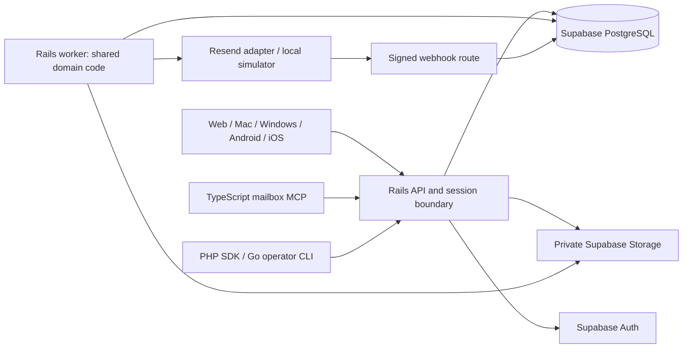

# Polyglot architecture proposal

Status: **planning only, 2026-10-12; pending research and named independent opinions**. This is the Astra MAX system-design proposal for the expanded brief, not an implemented stack or an approved final synthesis. Resend and self-hosted Supabase remain user-selected. The planning workload is approximately 10 staff and **9 email addresses across 1–2 domains**; the actual addresses, aliases, mailbox boundaries, domains and existing MX provider are unknown.

Read this with [reliability contracts](../docs/contracts-and-reliability.md), [local completion](../docs/local-completion-plan.md), [component adoption](../docs/component-adoption.md), [agent orchestration](AGENT_ORCHESTRATION.md) and [client/CLI design](CLIENTS_AND_CLI_CONNECTORS.md). Preserve their security and recovery invariants. Before implementation, reconcile their older Node/Tauri-for-both defaults with the accepted architecture ADR. This document does not authorize installation, external writes, purchases, real mail or production activation.

## 1. Recommended authority and topology

Recommend **one Ruby on Rails domain application**, deployed as an HTTP API and a separate worker from the same codebase/image. Rails owns application commands, mailbox authorization, approved send intent, inbound import and reconciliation. PostgreSQL owns durable records and constraints. Other languages consume the API or run bounded tools; they do not independently implement mailbox rules or write application tables.

Only the worker's provider adapter may perform outbound provider submission. API, clients, MCP, imports and tools cannot call Resend directly. Supabase Auth and Storage retain ownership of their internal schemas; Rails owns only the application schema and its migration lane. One authority means shared rules and a coordinated ledger, not an unsafe claim that only one process ever writes PostgreSQL.

Keep approval, immutable snapshot, job and audit insertion in one database transaction. Use the existing lease generations, dispatch boundary, stable payload/key and unknown-state handling. PostgreSQL documents `SKIP LOCKED` as useful for queue consumers; it is not general snapshot consistency. [PostgreSQL locking](https://www.postgresql.org/docs/current/sql-select.html).

Do not replace that ledger with `ActionMailer.deliver_later` or assume an after-commit enqueue cannot be lost. Rails documents that Solid Queue transaction behavior depends on database placement. Start with the explicit application job table and a Ruby worker; evaluate Active Job/Solid Queue only for non-authoritative housekeeping after a concrete need appears. [Rails job transactions](https://guides.rubyonrails.org/active_job_basics.html#transactional-integrity-on-jobs).

## 2. Delivery phases

| Phase | Work and deployment boundary | Exit evidence |
| --- | --- | --- |
| P0 — evidence/design | Inventory local UI; complete research and per-task opinions; choose contracts and record ADR | Verified sources, decisions, language ownership and unresolved alternatives |
| P1 — local core | Rails API/worker, PostgreSQL/Auth/Storage, React UI, local Express provider simulator | Two users complete persisted receive/assign/draft/approve/simulated-send/reply; restart and isolation tests |
| P2 — reliability/tools | Attachments/scanner, reconciliation, MCP, PHP SDK, Go diagnostics, Python fixtures, restore | Existing failure matrix, actual protocol tests, API conformance and measured local resource use |
| P3 — desktop | One Mac host and one C# Windows host; Anime.js refinement | Separate development installers and actual target-OS evidence; do not call a configured build a tested installer |
| P4 — mobile | Java Android APK and SwiftUI iOS client | Emulator/device lifecycle, authentication, permission and shared-contract checks |
| P5 — activation | Production topology, credentials, signing, DNS/migration and authorized external verification | Separate activation decision and real evidence; no secret values in chat or Git |
| PX — conditional extensions | Only a measured bottleneck, concrete integration or approved visual need | ADR naming benefit, alternative, maintainer, cost, threat boundary and removal criteria |

P4 can follow a stable desktop/web core without blocking its local proof. P5 does not erase incomplete native/mobile deliverables. Use synthetic nine-address fixtures on reserved test domains, including aliases and a private mailbox; test both one-domain and two-domain routing. Do not invent the real address list or equate nine addresses with nine users or nine mailboxes.

## 3. Every requested language has a bounded role

The rows below are proposed deliverables or explicit conditional roles, not claims that all these runtimes must run on the server. Required polyglot tools increase build and maintenance work even when they add no resident service.

| Language / framework | Real task or conditional role | Phase / runtime / authority |
| --- | --- | --- |
| Ruby / Rails | Domain services, JSON API, session boundary, ledger worker, Resend mapping and reconciliation | P1–P2; server API + worker; sole application write/send authority; Devin through Codex |
| SQL / PostgreSQL | Versioned application migrations, composite constraints, RLS, leases, audit/outbox and indexed search | P1; shared database; one reviewed migration lane, restricted API/worker roles |
| JavaScript / strict TypeScript | React/Vite mailbox UI, shared wire schemas, Node stdio MCP and adapter tests | P1–P3; clients/build tools/local connector; API access only |
| Express | Local deterministic HTTP provider simulator with durable acceptance ledger and fault controls | P1–P2; local/test only; never an additional production domain API. [Routing](https://expressjs.com/en/guide/routing/) |
| Anime.js | Small state-driven UI transitions, teardown and reduced-motion behavior | P3; bundled client code; Opus 5.5 owns motion. [Documentation](https://animejs.com/documentation/) |
| Rust / Tauri | Mac host, narrow native IPC, protected token handling and packaging | P3; Mac device only; no database/provider secrets. [Tauri architecture](https://v2.tauri.app/concept/architecture/) |
| Go | `elevateo doctor` operator CLI: authenticated aggregate health plus offline backup-manifest/checksum validation | P2; on-demand executable; read-only API, no SQL or automatic remediation. [HTTP library](https://pkg.go.dev/net/http) |
| PHP | Composer SDK and runnable read/search/draft integration example, conformance-tested against local Rails | P2; test/integration consumer only; Symfony HttpClient component candidate, no Laravel/Symfony server. [Standalone HTTP client](https://symfony.com/doc/current/http_client.html) |
| Python | Retain existing source-integrity tooling; generate synthetic MIME, malformed-input and failure fixtures | P0–P2; development/CI only; fixture parsing is not production sanitization. [Email parser](https://docs.python.org/3/library/email.parser.html) |
| Java / Android SDK | Android mailbox client and APK lane; no Java backend service | P4; Android device; shared API and platform credentials boundary. [Android fundamentals](https://developer.android.com/guide/components/fundamentals) |
| .NET / C# | Windows GUI/host and separate Windows installer; assess WPF or WinUI and bundled shared UI in client ADR | P3; Windows device; no ASP.NET duplicate API. WPF itself is Windows-only. [WPF](https://learn.microsoft.com/en-us/dotnet/desktop/wpf/overview/) |
| Swift / SwiftUI | iOS mailbox client, secure session/lifecycle behavior and native presentation | P4; iOS device; shared API. [SwiftUI](https://developer.apple.com/documentation/swiftui) |
| C | Conditional narrow binding to an indispensable maintained OS/library API; avoid a new mail parser in C | PX; bounded native helper only after need and memory-safety review |
| C++ | Interpret the user's “C+++” as C++; native bridge or Qt replacement experiment only for a demonstrated platform gap | PX; Opus 5.5 owns every C++ task; no competing shipped shell or domain server |
| Haskell | Conditional executable model/property generator for send-state transitions if ordinary failure tests prove insufficient | PX; offline verification; no domain DB or live provider access |
| F# | Conditional .NET property-model alternative where reuse by the C# client makes it worthwhile | PX; offline tests/library, not a new service; compare with Haskell/Clojure before selection |
| Clojure | Conditional event-replay/state-model tooling if evidence establishes a benefit over existing fixtures | PX; offline analysis only; do not start a JVM service to satisfy a language count |
| Lua | Conditional adapter for a confirmed Lua-hosted integration, restricted to validated API commands | PX; trusted host only; never execute scripts supplied by email or model output |
| Ray tracing | No mailbox use case established; optional visual experiment only with a specific approved benefit and measured energy/fallback costs | PX; optional decoration outside mail reading/sending; Opus 5.5 reviews |

Haskell, F# and Clojure are alternative verification experiments, not three mandatory parallel frameworks. Ionic/Capacitor, Electron and Qt remain client alternatives, as recorded in the client plan; adopt a replacement only through its ADR, not as additional shipped shells.

## 4. Why Rails, and what changes from Node

Rails is a proposed fit for the requested Ruby component and the transaction-heavy mailbox domain; this is a design judgment, not a benchmark victory over Node. It supplies a JSON API framework while React remains the UI. API-only Rails omits browser middleware by default, so explicitly add/test the same-origin cookie/session and CSRF boundary. Do not install a second identity system alongside Supabase Auth. [Rails API applications](https://guides.rubyonrails.org/api_app.html).

The tradeoff is losing same-language domain/schema reuse between TypeScript and server code. Use versioned wire contracts and generated or conformance-tested clients instead. Require runtime validation at all edges, Ruby domain signatures checked by one selected type checker, strict TypeScript and explicit nullable/error handling in native clients. Pin supported versions only after compatibility and maintenance checks; do not inherit upstream lockfiles.

Express remains useful for the simulator. Fastify/NestJS or Next.js server routes would compete with Rails if made a second domain backend; omit that duplication. PHP/Laravel, Python/Django/FastAPI, Go HTTP servers, Java/Spring and ASP.NET are alternative backend choices, not extra layers needed by this design. The requested languages already have bounded jobs above.

There is no integrated Node application to migrate in the inspected repository. Preserve the existing upstream snapshots, provenance and first-party work that appears before implementation. Re-map A02/A03/A04 domain candidates into Rails modules, A05 failure invariants into Ruby/PostgreSQL tests, A10/A11 into the Ruby provider adapter and A01/A08/A12 into the retained React UI. A09 remains a rewritten TypeScript MCP boundary. Translation still requires notices and provenance where based on source implementation.

Before coding: (1) accept the ADR after evidence gates; (2) update standards, architecture, API examples, local prompt/plan, adoption destinations, README and state together; (3) define the canonical SQL migration lane and OpenAPI contract; (4) prove one Rails vertical slice; (5) add adapters against that API. If working Node code appears meanwhile, inventory and compare migration cost before replacing it; never run both as independent writers during a transition.

## 5. API, event, provider and CLI contracts

- **One wire definition:** maintain `contracts/openapi.yaml` plus versioned event/CLI schemas and synthetic fixtures. Proposed baseline is OpenAPI 3.1.1, subject to generator compatibility; never claim it is the newest version. UUIDs remain strings, timestamps use UTC, sizes are bounded, pagination is opaque and errors include stable code/request ID. [OpenAPI 3.1.1](https://spec.openapis.org/oas/v3.1.1.html).
- **HTTP:** preserve existing `/v1` routes, current organization/mailbox checks, draft-version conflicts and idempotent immutable send approval. `202` means durable intent only. Clients can request approved operations; they never decide authorization from local roles. PHP/MCP grants expose read/search/draft, not send or administration. Go diagnostics uses a separately scoped operations-read endpoint with no message bodies.
- **Identity:** verify signature, issuer, audience, expiry and authoritative session/grant state on each protected request; also enforce configured time/inactivity limits. Supabase documents that a valid JWT may outlive sign-out and identifies sessions through `session_id`; row existence alone does not prove every lifetime condition. Current mailbox membership remains an independent check. [Supabase sessions](https://supabase.com/docs/guides/auth/sessions).
- **Database:** only the Rails API/worker use application roles; migrations use a separate deployment role. Set verified claims transaction-locally, deny client Data API access to application tables and test pooled connections plus real RLS roles. Supabase service/owner access is not an ordinary request role. [Supabase RLS](https://supabase.com/docs/guides/database/postgres/row-level-security).
- **Events:** persist domain outbox records with the change. Envelope: `event_id`, `schema_version`, `event_type`, organization/mailbox IDs, aggregate ID/version, occurrence time, correlation ID and bounded payload. Delivery is at least once; deduplicate by event ID and preserve aggregate ordering/version rules. Consumers recheck authorization, use no global data feed and cannot turn an event into a new send authority. No broker is required initially.
- **Provider adapter:** `submit(immutable_snapshot, stable_key, deadline)` returns accepted/provider ID, definitive rejection, or unknown; separate retrieve/import methods expose bounded provider facts. Domain code owns retry policy. Signed raw webhooks are durably stored before acknowledgment. Resend currently documents a 24-hour idempotency window; retain the shorter proposed 23-hour application horizon and revalidate it before activation. [Resend idempotency](https://resend.com/docs/dashboard/emails/idempotency-keys), [Ruby integration](https://resend.com/docs/send-with-ruby).
- **Simulator:** implement the same HTTP/request/signature semantics with its acceptance ledger outside the application restore target. Simulate lost responses after acceptance, reordering, duplicate events and key expiry. Local transport cannot fall through to Resend/SMTP; client UI explicitly identifies simulation.
- **CLI/process adapters:** use versioned JSON/NDJSON envelopes with command, request ID, schema version and bounded result/error; define exit codes, timeouts and cancellation. Secrets never enter arguments or output. Invoke fixed executables/argument arrays without a shell. Tool results are data; only Rails validates/commits any allowed domain change.
- **Attachments/native:** private Storage, quarantine/scanning and authenticated download proxy remain mandatory. Keep signed Storage URLs server-side. Native IPC is allowlisted and schema-validated; imported mail has no native capabilities. [Tauri capability boundary](https://v2.tauri.app/security/capabilities/). In-app agent bridges follow the separate client plan and do not inherit server secrets or human send authority.

## 6. Deployment footprint and efficiency

The first production candidate is static web assets behind TLS, one Rails API process, one Rails worker process and the essential self-hosted Supabase dependency set, plus required scanning and backup facilities. API and worker share one image but have separate commands/roles. The scanner may require an isolated process/container; include its memory/signature-update costs in measurement. Do not claim Supabase is a single process or strip services without checking their dependencies.

Node/Express simulator and Python test tools run in development/CI; PHP's adapter and Go's CLI run on demand; Rust/C#/Java/Swift run on user devices. Local MCP uses Node on the connecting workstation. No always-on PHP, Go, Python, Java or .NET backend is justified by nine addresses. Native installers do not bundle a database or mail server, and closing clients cannot stop server ingestion.

Start with PostgreSQL search and indexed bounded polling. Add Redis, an external search cluster, a message broker, a service mesh or Kubernetes only after measured need and an ADR. Measure ten-user concurrency, representative mailbox history and attachment workload: idle/peak RAM and CPU per service, p95 interactive latency, queue/import age, disk growth and backup/restore time. Select a host and budget from those results; no unmeasured RAM, cost or availability guarantee is made here.

One VPS is one failure domain. Production self-hosting includes patching, TLS, monitoring and independent encrypted database/object backups with restore drills; the local Supabase CLI stack is not a hardened public deployment. [Supabase self-hosting responsibilities](https://supabase.com/docs/guides/self-hosting). Retain dispatch-held restoration and the simulator's later external acceptance evidence so restoring an old app backup cannot silently resend accepted mail.

## 7. Research, consultation and execution gates

1. **Research intake pending acceptance:** the first actual assignment was dispatched through the user's Codex CLI for 20–25 repositories and at least six Reddit threads. The initial [candidate inventory](research/reuse-market-candidates.json) now records 25 repositories and eight threads, with six opened publicly and two limited to search snippets; commit pins and runtime tests remain unverified. Review the complete `.planning/research/reuse-market-*` evidence for exact paths, revisions, maintenance, license, security and integration cost. Reddit informs failure hypotheses, not API guarantees. Reconcile with the six existing dossiers before choosing code.
2. **Named opinions pending:** for each task, including bounded fixes, Astra MAX must separately start Fable 5, Opus 5.5 and Fable 5.1 opinion tasks, then record reasoned synthesis, disagreements and accepted/rejected recommendations. The coordinator reports three separate CLI attempts failed before inference because the OAuth session expired and could not refresh; these are attempted consultations, not completed opinions. No substitute model or invented output counts. Record actual model/effort/session IDs and recover these gates through the supported route before marking a design approved.
3. **Execution ownership:** Devin through Codex owns the professional backend implementation in task branches, commits, PRs and linked review issues. Each task records bounded scope, contracts, evidence, dependencies and completion checks. Astra LOW handles bounded defects against that design, with regression evidence; structural changes return to Astra MAX and the named opinions. Opus 5.5 owns motion and any C++ task. A planned assignment is not proof that a runtime/model is available.
4. **Review and activation:** adversarial implementation review covers at most 200 lines per assignment plus a separate design-tradeoff reviewer; record coverage, findings and repairs. Run application checks in Docker, actual browser tests and native tests on their target OS. Implementation-agent authentication for required opinions and Devin is a user-controlled prerequisite to accepting designs and running assigned implementation; it is not deferred behind those tasks. Application model/provider/signing credentials remain final activation inputs. Do not collect secret values in this planning document. The absent historical rubric is an explicit review limit, not permission to invent compliance.

## 8. Architecture acceptance and completion evidence

- A single accepted ADR reconciles the incoming research, four design perspectives, language roles, client choices and original Node proposal; unresolved opinions remain visible.
- One canonical migration lane and versioned contract exist; every adapter passes positive/negative conformance fixtures with current/revoked/foreign mailbox identities.
- Real PostgreSQL proves approval uniqueness, lease fencing, no transaction across provider I/O, unknown-send recovery, revocation and durable inbound ingestion; no polyglot component bypasses the authority.
- Two users complete the actual local workflow; all language deliverables claimed complete have executable evidence. Conditional languages remain conditional, not fabricated features.
- Database/object restore, scanner outage, adversarial HTML, client disconnection and nine-address routing have recorded results; measurements determine the production proposal.
- Mac and Windows have separate tested installer lanes; Android and iOS have separate runtime evidence. Report implemented, simulated, externally activated, blocked and not-run items distinctly; signatures, DNS and real mail stay outside this planning task.
