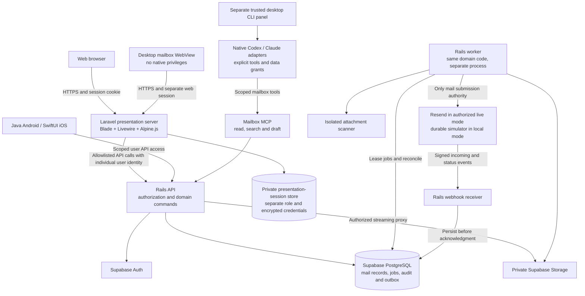

# Elevateo Mail architecture diagram

Updated 2026-10-13. User-selected stack: **Rails domain backend + Laravel Blade/Livewire web UI + self-hosted Supabase + Resend**. This is a design diagram, not deployed infrastructure. Local tests replace external mail transport with the durable simulator; live sends and Instantly warmup remain disabled.

There is deliberately **no connection from the remote mailbox WebView to the native CLI panel or its IPC**. They do not share a JavaScript bridge, host objects, pairing tokens or credential store. The trusted panel obtains explicitly granted mailbox context through the API/MCP; remote page events cannot authorize local execution.

Laravel handles presentation and browser session/CSRF protection. Rails owns every mailbox permission decision, mutation, domain migration, send state and provider integration. Laravel has no mail-table, Storage administrative or Resend access. Its only database privilege is the isolated presentation-session store if PostgreSQL is selected for that store; it must not use Supabase service-role access.

Desktop mailbox sessions behave as isolated web sessions. Native assistant/native-mobile sessions use their own reviewed system-browser/PKCE enrollment and OS-protected credentials; no token is passed between views through URLs or JavaScript. Android/iOS are separate native clients of the same API. Mac and Windows have separate installers.

The diagram omits the TLS reverse proxy, backup destination and observability plumbing for clarity. The reverse proxy routes the web UI to Laravel and authenticated API/webhook paths to Rails; it does not weaken either application's authorization. See [architecture](architecture.md), [framework decision](decisions/0002-rails-laravel-presentation.md), [reuse playbook](component-reuse-playbook.md) and [cross-platform tests](cross-platform-testing.md).
