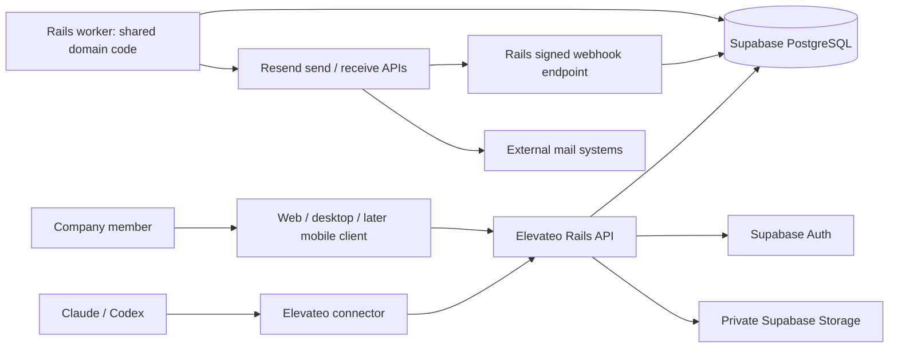

# System architecture

Status: **expanded provisional design, not implementation**. The [polyglot proposal](../.planning/POLYGLOT_ARCHITECTURE.md) recommends one Rails domain application with separate API and worker processes from the same codebase. Required independent Fable 5, Opus 5.5 and Fable 5.1 opinions remain pending: all three attempts failed authentication before inference. This document aligns the proposed architecture; it does not claim an accepted final synthesis or a built application.

## Context: what each system owns



Elevateo owns users' mailbox access, conversations, assignments, immutable send intent, reconciliation and audit records. Supabase is the application data/identity foundation. Resend handles internet email transport. This is self-hosted application storage with an external mail processor; mail also exists at Resend and recipient providers. Self-hosting Supabase does not make the whole email path private or self-hosted.

The planning workload is approximately ten staff and nine email addresses across one or two domains; exact addresses, aliases, mailbox boundaries and existing MX ownership remain unknown. Local execution replaces Resend with a deterministic provider simulator and blocks live mail transport. The production path in the diagram is a target, not an activated integration.

## Containers and runtime responsibilities

| Component | Responsibility | Persistent data |
| --- | --- | --- |
| React/Vite UI | Inbox, composer, search, settings, review before send | No authoritative message state on device |
| Rust/Tauri Mac host | Bundled UI and tightly scoped macOS integration; separate DMG | Protected session material only; offline mail deferred |
| C#/.NET Windows host | Requested Windows GUI/host and separate installer; assess shared UI integration in the client ADR | Protected session material only; no local domain database |
| Later Java Android / SwiftUI iOS clients | Native mobile views and lifecycle integration over the same API | Protected session material only; offline mail deferred |
| Rails API | Authentication, authorization, validation, domain commands, transactions, webhook receipt | PostgreSQL and Storage |
| Rails worker | Same domain code; claimed jobs, send/reconcile, inbound import and attachment processing | PostgreSQL job/attempt/event ledgers |
| Supabase Auth | Identity, sign-in, token issuance | Supabase database |
| PostgreSQL | Company records, constraints, RLS, durable queue | Encrypted disk plus independent backups |
| Supabase Storage | Private attachments and optionally archived raw messages | Persistent object storage plus backups |
| Reverse proxy | HTTPS, request size limits, route separation | Certificates and config |
| TypeScript local stdio MCP bridge | Adapts Claude/Codex tools to Elevateo API | Scoped expiring user grant, never provider secret |
| TypeScript/Express provider simulator | Local/test-only provider behavior, signing and controlled faults | Independent durable acceptance ledger outside application restore |

Pin supported Ruby/Rails, Node and native toolchains after compatibility checks. TypeScript remains strict; check Ruby domain signatures with one selected type checker and validate wire values independently in every runtime. No dependency is installed by this design update. See the [client plan](../.planning/CLIENTS_AND_CLI_CONNECTORS.md) for platform choices and Anime.js ownership.

## Why one domain authority and few services

The repository contains reference snapshots but no integrated Elevateo runtime to migrate. The expanded brief proposes Rails for the transaction-heavy domain and preserves React/Vite for the UI. This replaces the earlier Node-domain proposal; it is not an additional backend. Rails API and worker share one domain implementation and one application migration lane. Only the worker's provider adapter submits mail. Supabase Auth and Storage continue to own their internal schemas.

The tradeoff is losing same-language server/client domain reuse. Versioned OpenAPI/event schemas, TypeScript bindings and cross-language contract tests replace that assumption. PHP has a scoped SDK/example, Go a read-only diagnostics CLI and Python fixture/provenance tools; these do not become always-on domain servers. All requested languages, conditional roles and phases are recorded in the [polyglot matrix](../.planning/POLYGLOT_ARCHITECTURE.md).

Do not merge Python, Go and Node servers simply to collect features from every repository. Port small, valuable rules and regression cases into the chosen architecture. Start with PostgreSQL search, a durable jobs table and modest polling for UI changes. Add Realtime only for measured UX need, Redis only for a measured queue/cache bottleneck, and an external search engine only when indexed database search no longer meets measured needs. There is no Kubernetes or microservice mesh requirement for 10 people.

## Module boundaries

Proposed repository structure (illustrative; these directories do not exist yet):

```text
apps/web/                              React/Vite browser and reusable desktop UI
apps/server/app/controllers/           Rails HTTP/session/webhook boundary
apps/server/app/domain/                Ruby mailbox access, drafts, sends, threading
apps/server/app/workers/               shared-domain lease/import/reconciliation loop
apps/server/app/adapters/providers/    Ruby Resend and simulator HTTP adapters
apps/server/db/                        sole application SQL migration/schema lane
apps/server/test/                      Ruby/domain and real-PostgreSQL tests
apps/provider-simulator/               TypeScript/Express local-only fake provider
apps/desktop-macos/                    Rust/Tauri host and Mac packaging
apps/desktop-windows/                  C#/.NET host and Windows packaging
apps/mobile-android/                   later Java Android client
apps/mobile-ios/                       later SwiftUI iOS client
contracts/                            canonical OpenAPI/event/CLI wire schemas
packages/contracts/                   TypeScript bindings and boundary validators
packages/ui/                          shared React presentation primitives
packages/mcp/                         TypeScript stdio tools calling the Rails API
tools/                                bounded Go/PHP/Python tools and fixtures
infra/                                app deployment and pinned Supabase integration
```

Rails routes call Ruby domain services; domain services use a transaction/repository interface; the provider adapter translates Resend-specific responses. The API and worker are two commands from one server image. UI, SDKs and MCP have no direct database or Resend credentials. TypeScript contracts describe wire data, not a second domain implementation. The simulator owns only simulated external effects; it cannot write application state directly.

## Trust and authorization

For web, use a same-origin backend-for-frontend session: secure HttpOnly cookies, CSRF protection on mutations and restricted origins. Supabase Auth verifies identity; the API verifies token signature/issuer/audience/expiry and checks authoritative session validity plus current membership for every operation. A still-unexpired JWT alone is insufficient after device/session revocation; use a narrow server-side session lookup and fail closed when it is unavailable. Do not trust a client-supplied organization ID or a role cached forever in a JWT.

Rails API-only applications omit browser middleware by default; add and test the required cookie/session and CSRF boundary explicitly. Keep Supabase as the identity authority. Enforce configured time/inactivity limits as well as session existence. [Rails API middleware](https://guides.rubyonrails.org/api_app.html), [Supabase sessions](https://supabase.com/docs/guides/auth/sessions).

For desktop, use the system browser with authorization code/PKCE, strict redirect handling and OS-protected session storage. For connectors, issue revocable grants scoped to a user, organization, explicit mailboxes and read/draft actions. Never expose a Supabase secret/service-role key, database URL, signing key or Resend key in the UI, installer or MCP configuration.

Keep business tables in a non-public application schema, not automatically exposed through the Data API. Use explicit grants and RLS as defense in depth. If the API connects directly to PostgreSQL, its request connection must assume a restricted role with verified user claims set **transaction-locally**; pooled connections must not leak claims between requests. Do not run ordinary requests as a database owner, superuser or BYPASSRLS role. Validate this with actual PostgreSQL role tests. Worker operations use a separate narrowly granted role; any privileged helper must validate the job and mailbox boundary itself.

Storage object access is mediated by authorized attachment metadata. A random object path is not authorization. User downloads pass through an authenticated API/proxy that rechecks current session/grant and mailbox access on each new request. Any short-lived Storage signed URL remains server-side; clients cannot bypass revocation by reusing it. Quarantined objects cannot be downloaded. Already received bytes cannot be recalled. Keep Storage RLS and server access rules consistent with this boundary.

## Where consistency matters

One database transaction records the approved immutable draft version, a uniquely identified send job and audit event. It does not send the email. A worker atomically leases the job, records an attempt and commits, then calls Resend outside that transaction. This separates durable intent from an unreliable network operation.

The application job ledger remains authoritative in Rails. Do not substitute Action Mailer or a generic after-commit enqueue for atomic send intent; queue transaction behavior depends on backend/database placement. [Rails job transactions](https://guides.rubyonrails.org/active_job_basics.html#transactional-integrity-on-jobs).

Provider acceptance, delivery, bounce and human reading are different facts. UI labels must reflect evidence. The worker persists a stable provider idempotency key and a first-attempt time. A timed-out request is `unknown`, not `failed`. Retries may use the same bytes/key within the provider's safe window; after that window, reconciliation or an explicit human resolution is necessary. A lease alone cannot fence an external provider; see [the failure matrix](contracts-and-reliability.md).

Incoming events are authenticated and saved before a success response. Separate import work obtains body/attachments, checks known recipient addresses and builds mailbox-scoped conversations. Duplicates and out-of-order events are normal. Event replay must not duplicate messages or reopen cancelled jobs.

## Resource efficiency and failure domains

A VPS can run the Rails API, one worker and essential Supabase services behind TLS, with the required scanner and backup facilities included in resource measurements. It is economical in service count but is one failure domain: a VPS outage stops the app and database. Backups improve recoverability; they do not provide high availability. Start with a measured pilot, then separate database/object storage or add a standby only when recovery requirements justify the cost.

Web, desktop and mobile are clients of the same service, not copies of Supabase on every device. Closing every client must not stop inbound ingestion or accepted send jobs. Client disconnection may preserve a local draft later, but it cannot safely approve or report a send as successful without the server. Mac/Tauri and Windows/C# have separate installers; Java Android and SwiftUI iOS follow the stable core. Electron, Ionic/Capacitor and Qt remain alternatives rather than additional shipped shells.

See [hosting](mail-delivery-and-hosting.md) for operator responsibilities, [desktop/connectors](desktop-and-connectors.md) for distribution, and [the tutorial](backend-database-tutorial.md) for the database model and CAP.
