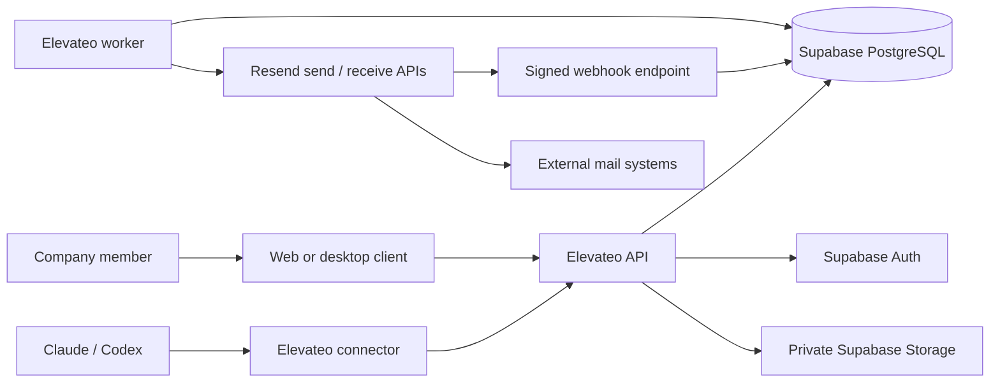

# System architecture

Status: proposed design, not implementation. This is a modular monolith with a separate worker process: one codebase owns the business rules, while two processes handle interactive requests and recoverable background work.

## Context: what each system owns



Elevateo owns users' mailbox access, conversations, assignments, immutable send intent, reconciliation and audit records. Supabase is the application data/identity foundation. Resend handles internet email transport. This is self-hosted application storage with an external mail processor; mail also exists at Resend and recipient providers. Self-hosting Supabase does not make the whole email path private or self-hosted.

## Containers and runtime responsibilities

| Component | Responsibility | Persistent data |
| --- | --- | --- |
| React/Vite UI | Inbox, composer, search, settings, review before send | No authoritative message state on device |
| Tauri shell | Packages UI, tightly scoped OS integration | Secure session store only; offline mail deferred |
| Node API | Authentication, authorization, validation, transactions, webhook receipt | PostgreSQL and Storage |
| Node worker | Claimed jobs, send/reconcile, inbound content import, attachment processing | PostgreSQL job/attempt/event ledgers |
| Supabase Auth | Identity, sign-in, token issuance | Supabase database |
| PostgreSQL | Company records, constraints, RLS, durable queue | Encrypted disk plus independent backups |
| Supabase Storage | Private attachments and optionally archived raw messages | Persistent object storage plus backups |
| Reverse proxy | HTTPS, request size limits, route separation | Certificates and config |
| Local stdio MCP bridge | Adapts Claude/Codex tools to Elevateo API | Scoped expiring user grant, never provider secret |

Use an active Node LTS at implementation and pin exact tool/dependency versions with a lockfile. A small validated framework such as Fastify is a candidate; pick and pin after a compatibility/security check. No runtime package was selected or installed in this planning update.

## Why one language and few services

The target repository has no application code to preserve. A TypeScript frontend and backend can share validation schemas and typed API contracts, while Tauri adds only a narrow Rust shell. That is a new design choice for this greenfield product; the audit's recommendation to start from Quickly was for a campaign-heavy product, not this changed requirement.

Do not merge Python, Go and Node servers simply to collect features from every repository. Port small, valuable rules and regression cases into the chosen architecture. Start with PostgreSQL search, a durable jobs table and modest polling for UI changes. Add Realtime only for measured UX need, Redis only for a measured queue/cache bottleneck, and an external search engine only when indexed database search no longer meets measured needs. There is no Kubernetes or microservice mesh requirement for 10 people.

## Module boundaries

Proposed repository structure (illustrative; these directories do not exist yet):

```text
apps/web/              shared browser/Tauri frontend
apps/api/              HTTP boundary, session middleware, route wiring
apps/worker/           background process and lease loop
apps/desktop/          Tauri shell and OS packaging
packages/domain/      mailbox access, drafts, send state, threading rules
packages/contracts/   input/output schemas and versioned API types
packages/database/    migrations, repositories, transaction helpers
packages/providers/   Resend adapter and fake transport for tests
packages/mcp/         stdio tools that call the API with user grants
infra/                app deployment and pinned Supabase integration
```

API routes call domain services; domain services use a transaction/repository interface; the Resend adapter translates provider-specific responses. The UI and MCP bridge have no direct database or Resend credentials. The worker shares domain code rather than invoking unreviewed SQL copied into a second implementation.

## Trust and authorization

For web, use a same-origin backend-for-frontend session: secure HttpOnly cookies, CSRF protection on mutations and restricted origins. Supabase Auth verifies identity; the API verifies token signature/issuer/audience/expiry and checks authoritative session validity plus current membership for every operation. A still-unexpired JWT alone is insufficient after device/session revocation; use a narrow server-side session lookup and fail closed when it is unavailable. Do not trust a client-supplied organization ID or a role cached forever in a JWT.

For desktop, use the system browser with authorization code/PKCE, strict redirect handling and OS-protected session storage. For connectors, issue revocable grants scoped to a user, organization, explicit mailboxes and read/draft actions. Never expose a Supabase secret/service-role key, database URL, signing key or Resend key in the UI, installer or MCP configuration.

Keep business tables in a non-public application schema, not automatically exposed through the Data API. Use explicit grants and RLS as defense in depth. If the API connects directly to PostgreSQL, its request connection must assume a restricted role with verified user claims set **transaction-locally**; pooled connections must not leak claims between requests. Do not run ordinary requests as a database owner, superuser or BYPASSRLS role. Validate this with actual PostgreSQL role tests. Worker operations use a separate narrowly granted role; any privileged helper must validate the job and mailbox boundary itself.

Storage object access is mediated by authorized attachment metadata. A random object path is not authorization. Signed URLs are short-lived and generated only after current mailbox checks; quarantined objects never receive download URLs. Choose consistent Storage RLS and server access rules before implementation.

## Where consistency matters

One database transaction records the approved immutable draft version, a uniquely identified send job and audit event. It does not send the email. A worker atomically leases the job, records an attempt and commits, then calls Resend outside that transaction. This separates durable intent from an unreliable network operation.

Provider acceptance, delivery, bounce and human reading are different facts. UI labels must reflect evidence. The worker persists a stable provider idempotency key and a first-attempt time. A timed-out request is `unknown`, not `failed`. Retries may use the same bytes/key within the provider's safe window; after that window, reconciliation or an explicit human resolution is necessary. A lease alone cannot fence an external provider; see [the failure matrix](contracts-and-reliability.md).

Incoming events are authenticated and saved before a success response. Separate import work obtains body/attachments, checks known recipient addresses and builds mailbox-scoped conversations. Duplicates and out-of-order events are normal. Event replay must not duplicate messages or reopen cancelled jobs.

## Resource efficiency and failure domains

A VPS can run the API, one worker and essential Supabase services behind TLS. It is economical in service count but is one failure domain: a VPS outage stops the app and database. Backups improve recoverability; they do not provide high availability. Start with a measured pilot, then separate database/object storage or add a standby only when recovery requirements justify the cost.

Web and desktop are clients of the same service, not copies of Supabase on every laptop. Closing every desktop app must not stop inbound ingestion or accepted send jobs. Client disconnection may preserve a local draft later, but it cannot safely approve or report a send as successful without the server.

See [hosting](mail-delivery-and-hosting.md) for operator responsibilities, [desktop/connectors](desktop-and-connectors.md) for distribution, and [the tutorial](backend-database-tutorial.md) for the database model and CAP.
