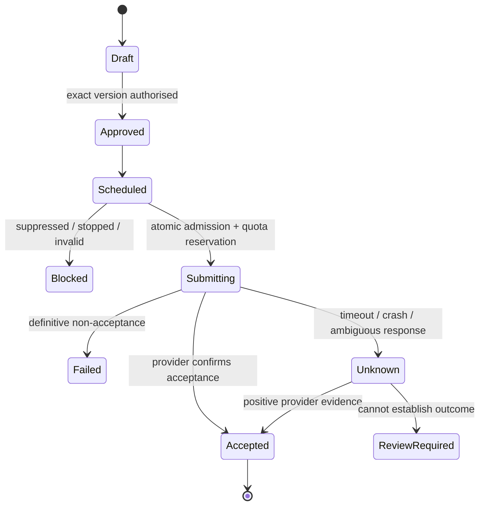

# Elevateo Mail — backend implementation blueprint

Status: proposal, 4 October 2026. Read the [master plan](product-master-plan.md) first. This is the precise companion for engineers and implementation agents, not approval to build. Latest user decisions override older research scenarios; approved frontend standards continue to apply to the prototype. Backend standards require approval.

## 1. Rules the implementation must preserve

- Client scope now includes web, Windows and macOS; all share this backend and its quotas. See master plan section 11 and the distribution PDF addendum. Local CLI AI is initially desktop-only. Mac credential storage, sandboxing, OAuth return handling and CLI discovery require OS-specific validation; Windows-specific guidance below must not be assumed portable.
- Ten independent users, each with up to ten connected mailboxes (100 total). No shared workspace, delegated mailbox or shared campaign features in the first release.
- Existing Google inboxes connect through Gmail API; self-hosted mail requires a tested capability adapter. Resend is the chosen sender for opted-in campaigns on verified domains. Personal Gmail addresses require Gmail sending, not a forged Resend From address.
- Maximum 30 outgoing emails per connected mailbox per day, including manual/AI/campaign sends. Proposed conservative definition: each recipient delivery counts in a rolling 24 hours. Aliases share the mailbox counter; reconnect does not reset it. Ten mailboxes make the effective pilot maximum 300/user/day and 3,000 total/day. The earlier 600/user/day ceiling is relevant only to a later mailbox expansion. Lower provider limits win. Sending outside this app is not enforceable by this app.
- Only an authorised, approved message can reach a sending provider. Consent and suppression are checked again at dispatch. A contact lookup is not permission to email.
- An uncertain provider result is **unknown**, never automatically labelled failed and sent again.
- No company root MX changes. Mail workers and AI have no DNS-write credentials. A separate broker may change exact records on explicitly approved subdomains after human review; the reported existing `in.elevateoco.com` pipeline stays protected. Zone-wide provider credentials are not a true subdomain boundary.
- Each user's private Connections area grants AI read access only to selected mailboxes and app-draft creation by default; sending is separately enabled and exact actions approved. MCP tools call the same backend services as the UI.
- Scheduled, approved content continues in the cloud when desktops are off. New local AI generation does not.
- Private data must remain private across database rows, object storage, caches, jobs, logs and AI sessions.

## 2. Code ownership and repository migration

Use one repository and one modular backend, deployed as API, scheduler and queue entry points. Separate deployments/processes do not require independently versioned microservices.

The following is a destination map, not a request to scaffold empty packages. Begin with one inbox and two-user isolation. Extract shared packages only when a second consumer needs them; add provider adapters one at a time as their behaviour is verified.

| Location | Owns | Must not own |
| --- | --- | --- |
| `apps/desktop/src` | Screens, pending/error state, paginated cache | Provider keys, consent decisions, authoritative counters |
| `apps/desktop/src-tauri` | Windows lifecycle, safe local IPC, CLI process control | Arbitrary shell requests from email content |
| `apps/backend` | Auth, use cases, scheduling, transactions, HTTP and queue handlers | React components |
| `packages/domain` | Pure eligibility, quotas, campaign state and send rules | Network, UI or database calls |
| `packages/contracts` | Versioned boundary schemas and response types | Secrets or persistence implementation |
| `packages/providers` | Gmail/Resend adapters and capability declarations | Campaign policy or scheduling authority |
| Separate DNS broker, only when enabled | Approved record plans, narrowly permitted changes, reconciliation/audit | Mail bodies, campaign dispatch or unrestricted agent tools |
| `infra` | Reviewed migrations, environment config and deployment instructions | Live credentials or root MX automation |
| `tests` | Cross-module scenarios, fake providers, load/GUI harnesses | A duplicate implementation of business rules |

Keep the existing frontend working during migration. First move its direct store writes behind `MailroomGateway`; add pending, conflict, retry and rollback behaviour. Replace whole-state `load()` with bounded list/detail endpoints. Preserve URL navigation state; use Zustand for UI/cache, not a second server database.

Update UI and contracts together: real Gmail messages have multiple labels, not one stored folder; sender identities are dynamic and verified; server acceptance is not delivery; uncertain sends need a visible state. Classify message purpose explicitly. Removing a campaign ID or calling a marketing follow-up a reply must not bypass suppression.

Dependencies point toward domain rules. Provider adapters expose only capabilities they actually implement: send, fetch, reconcile, inbound events, identity verification. Do not assume all providers share Gmail threading or Resend idempotency.

## 3. Identity, permissions and data

Propose Google sign-in for the app through the system browser and a supported native PKCE flow. App login and permission to read/send a mailbox are distinct grants. Server sessions are revocable and short-lived; desktop refresh material belongs in Windows-protected credential storage. Never embed an OAuth client secret in the desktop. Decide MFA enforcement before production; personal Google sign-in alone is not proof of MFA.

Specify the Google Desktop client flow, S256 PKCE, state/nonce checks, an ephemeral loopback callback and server-side identity-token validation during the auth spike. The callback is a short-lived OAuth endpoint, not an AI control server. Validate the separate grant/storage arrangement needed for unattended cloud mailbox access before implementation. [Google native-app OAuth](https://developers.google.com/identity/protocols/oauth2/native-app)

Server derives `owner_user_id` from the authenticated session, never from a trusted-looking body field. Every lookup and update includes ownership; composite foreign keys/unique constraints prevent accidental cross-user associations. External webhook ownership comes from a registered connection and authenticated provider context, not an email address in untrusted JSON.

| Record | Essential meaning/constraint |
| --- | --- |
| User | Private account, preferences, storage and sending allowances |
| Connection | Google account or Resend integration; owner, provider identity, credential reference, status |
| Connection capability / AI grant | Supported provider operation, user-enabled permission, selected mailbox, expiry and revocation version |
| Domain scope / change plan | Owner-approved zone and exact names/types, baseline records, immutable reviewed change and audit result |
| Sender identity | Verified From/reply address; stable quota mailbox; aliases cannot mint quota |
| Message and labels | Owner + connection + provider message ID unique; provider thread ID scoped to connection |
| Contact and consent | Normalised address, evidence source/time, purpose/brand, current eligibility |
| Suppression | Owner + address + scope/reason; default user-wide marketing stop; no leak to other users |
| Campaign/version | Immutable approved content, recipients, schedule, timezone and sending authority |
| Recipient step | One intended step per campaign version/recipient; stopped/replied/eligible state |
| Draft | Revision, sender, recipients, body, attachment references; optimistic edit checks |
| Send intent/attempt | Frozen content hash, action ID, provider key, admission, result and reconciliation state |
| Event receipt/outbox/job | Deduplicated provider event; work durably committed with its originating change |
| Import | Ownership, byte/count reservation, stage, checkpoints, failures and expiry |
| Audit/health | Minimal authorised action history and redacted operational measurements |

Bodies/attachments live in R2 under opaque owner-scoped keys. Downloads require fresh authorisation and short-lived URLs; never trust a client-supplied object path. HTML is sanitised and rendered in an isolated view without script, remote images or active content by default. Do not automatically open attachments or fetch arbitrary URLs found in emails.

Each user supplies their own Resend/Hunter/confirmed-AMF credentials. Encrypt stored provider credentials with versioned envelope encryption and a wrapping key outside D1; plan rotation and revoke on disconnect. Cloud sending needs cloud access to those credentials. This is not end-to-end encryption against the operator. Local CLI login material stays local; do not upload subscription session tokens.

Connection, MCP and DNS contracts are in [Connections](connections/README.md). Provider capability and user permission are separate: a Gmail grant capable of sending does not enable AI sending. Start with app-local draft records to avoid an unnecessary provider-side draft grant. User-supplied endpoints require connection-time SSRF protection; do not weaken it to reach private networks. Private servers need a separately supported always-on route for PC-off operation. Resend sending-only keys cannot call read APIs, so recovery must use supported authenticated events or an explicitly granted read path; unavailable reconciliation remains visible as unknown.

## 4. API contract

Use HTTPS JSON endpoints under `/v1`, schema validation for bodies/query/cursors/webhooks/env, stable error codes and a request ID. Representative routes: connections, identities, threads/messages, drafts, contacts/imports, campaigns, send-actions, health, exports and account removal. Define actual OpenAPI contracts alongside implementation, not an invented giant API now.

Lists return `{items, nextCursor}` with a maximum page size of 100. Avoid full-table counts on every navigation. Draft/campaign changes carry `expectedRevision`; conflicts return the latest revision instead of overwriting it. UI distinguishes saved draft, scheduled, submitting, accepted, unknown and failed.

Creating a send or activating a campaign accepts a user-scoped idempotency key. Repeating it with the same payload returns the original result; a different payload is a conflict. Persist action identity long enough to survive retries, restore and archival. Apply per-user request/import quotas and explicit maximum request/attachment sizes. Never return raw provider credentials or exception dumps.

## 5. Sending, quotas and recovery



Delivery, bounce, complaint and reply are separate event facts following acceptance. Events can arrive before the send response, duplicated or out of order; store evidence and derive a consistent view instead of letting the latest arrival overwrite history.

At admission, one atomic database transition must check campaign version/status, recipient permission, suppression, approved sender, sync health for follow-ups, and both mailbox/user allowance. Reserve recipient counts across all provider paths. Pending reservations and unknown outcomes retain quota conservatively; definitive non-acceptance can release a reservation. Provider usage outside the app can only be observed imperfectly, so show that limitation.

Define the window using actual dispatch timestamps, not campaign creation time. Admission has a short dispatch deadline; delayed work must renew/revalidate atomically before sending. Reservations cannot expire out of quota while still able to send. Accepted attempts count from dispatch; unresolved pending/unknown attempts retain capacity conservatively until reconciliation. Test a stalled submission across the 24-hour boundary.

The critical boundary: suppression or pause committed **before** admission prevents dispatch. If committed after admission, the provider request may complete. UI and tests must represent this unavoidable external-call boundary. A separate preflight SELECT followed by a send is insufficient.

Use D1 atomic batches/conditional SQL appropriate to its API. A statement affecting zero rows does not abort a batch. Dependent inserts must use conditions tied to a successful transition, and callers must verify affected rows. Use the authoritative database/session consistency for dispatch checks. Do not assume PostgreSQL locks or `SKIP LOCKED` exist.

Commit intent/state and an outbox record together. An outbox relay publishes only IDs to Queues; duplicate publish is safe. Queue delivery is at least once. Consumers claim work conditionally and never trust message payloads to grant permission. Cap concurrency per mailbox and give users fair turns.

Persist `submitting` before the external request. Timeout, crash after acceptance, or lease expiry during submission becomes unknown, not a fresh retry. Lease fencing prevents stale database writes; it cannot cancel a network request already sent. A deterministic Message-ID aids reconciliation but Gmail does not thereby promise deduplicated sending. Absence from Sent after a grace period is not proof that a message was never sent.

For Resend, use a stable key and frozen payload within its documented 24-hour idempotency window. Retry only according to that verified provider contract; outside the window, reconcile or require review. Never switch an uncertain send to Gmail, another provider or Claude fallback. Distinguish safe retry of definite rejection/rate limiting from replay of a possibly accepted message. [Resend idempotency](https://resend.com/docs/dashboard/emails/idempotency-keys)

Campaign activation snapshots consent-eligible recipients, content, sender, schedule and version. Precompute required personalisation while the PC is on; a missing approved draft pauses that step. Edits invalidate relevant approval. Use UTC instants plus an explicit IANA timezone; test daylight-saving gaps and repeats. Campaign sending budget defaults below 30 where the user reserves room for personal mail.

Instantly/Smartlead remain optional later adapters. One campaign has exactly one execution authority. Transfer requires confirmed pause and reconciliation at the old authority. External provider cancellation is not atomic with our database: disclose delay and disable unsupported promises. A local pause badge alone is insufficient.

## 6. Incoming mail and notifications

```mermaid
sequenceDiagram
  participant G as Gmail / PubSub
  participant A as Ingest API
  participant D as Database / outbox
  participant W as Sync worker
  participant U as Desktop
  G->>A: Authenticated change notification
  A->>D: Persist deduplicated receipt + work
  A-->>G: Acknowledge after durable capture
  W->>G: Read history since stored cursor
  W->>D: Upsert messages, labels, replies; advance cursor
  U->>A: Bounded change check while running
  A-->>U: New owned changes / sync status
  U->>U: Deduplicated Windows notification
```

Validate Google push JWT signature, issuer, audience and expected service identity; provider webhooks require their documented signature scheme, replay checks and registered connection mapping. Authentication failure does not enqueue work. Acknowledge success only after durable capture. Store minimum receipt data and bound payload size.

Gmail notifications signal changes, not message content. Renew watches daily before expiry, serialize sync per mailbox, and checkpoint only after committed processing. History gaps/404 trigger bounded resynchronisation; notification drops trigger periodic reconciliation. Historical imports/full scans must not generate a storm of “new mail” alerts or pretend an old reply just arrived.

Track **last successful sync**, not last changed message. Quiet inboxes are healthy. Proposed active follow-up freshness threshold: five minutes; stale mailbox state pauses automated follow-ups until reconciliation. This reduces missed-reply risk but cannot eliminate a reply arriving just after admission. Initial reconciliation cadence: about five minutes for active campaign mailboxes, slower for idle ones; measure quota/cost and tune. Push usually improves responsiveness; a 60-second desktop notification goal is not a provider delivery guarantee. [Gmail push](https://developers.google.com/workspace/gmail/api/guides/push), [sync](https://developers.google.com/workspace/gmail/api/guides/sync)

Replies to Resend campaigns should reach the user's connected receiving mailbox. Persist outgoing Message-ID/provider IDs; prefer References/In-Reply-To/provider thread evidence for matching, with a visible unmatched-reply queue. Subject alone is insufficient. The reported company root-address inbound routes remain at Google. A separate app receiving subdomain is an explicitly approved integration only; receiving in Resend does not by itself connect an existing Google or arbitrary IMAP mailbox.

Close-to-tray may keep notifications active; Quit stops the desktop process. Make this visible. While the PC is off, cloud sync and approved campaigns continue; Windows cannot display notifications then. On restart, show a deduplicated catch-up summary, not hundreds of popups. Notification previews should be private by default and open the correct user's conversation.

## 7. Consent, imports and optional enrichment

Store permission evidence and purpose, not just a checkbox copied from a CSV. Hunter and AMF provide optional enrichment data; AI performs personalisation from permitted facts and user instructions. EmailGuard provides optional validation/deliverability information. None can set consent. Store enrichment source and freshness separately from generated drafts and approval versions; missing enrichment must not block ordinary inbox use or already-approved sending. Integration failure leaves sending rules intact. Consent withdrawals, complaints and hard bounces stop applicable campaigns; repeated soft failures follow an explicit bounded retry policy. Personal correspondence requires its own policy and cannot be a way to reclassify marketing.

Unsubscribe uses a high-entropy, recipient/list-scoped token and an idempotent unauthenticated endpoint with no exposed address. Support standards-compatible one-click POST where required; a normal GET displays a confirmation page so link scanners do not casually unsubscribe people. A successful unsubscribe commits suppression and cancellation eligibility together. Do not require login or a CSRF cookie for the verified one-click flow. [Google sender requirements](https://support.google.com/mail/answer/81126)

Google mailbox connection uses OAuth; supported self-hosted providers use their reviewed authentication method and least-privilege credentials. Typing an address does not authorise sending as it. CSV contacts and historical EML/MBOX imports use staged, resumable jobs with byte/count reservations, strict parsing and deduplication. Confirm format support during the import spike; never advertise PST before an implementation exists. Cap parser memory, MIME nesting, attachment sizes and decompression expansion. No automatic archive execution or remote resource fetching.

Separate imported history from live Gmail state. Importing a sent message must not send it again, change consent or trigger a campaign. Imported files can be the only copy, so they are durable user data, not disposable cache. Quota failure must stop cleanly before partial uncontrolled growth and provide a resumable/error report. Temporary staging objects expire; final user imports do not disappear under cache eviction.

## 8. AI boundary and Windows resource budget

Local host talks to a pinned Codex app-server protocol over standard input/output, with a supported Windows sandbox. No open unauthenticated localhost control port. Tauri permissions protect app commands but do not sandbox a child process. Restrict accessible directories/actions and prevent email content from choosing commands or paths.

Stdio proves transport only. The pinned-version spike must demonstrate denied access to unrelated credentials, denied unauthorised writes/network, correct approval handling and cancellation under the effective permission profile. Do not infer Windows enforcement from another platform's configuration. [Codex app-server](https://learn.chatgpt.com/docs/app-server), [permissions](https://learn.chatgpt.com/docs/permissions)

Claude fallback starts as tools-disabled drafting, with no MCP servers/hooks or permission escalation. Native Windows Claude shell execution is not accepted as sandboxed. Broader tools need independently verified isolation and a resource benchmark. Fallback never replays a send; tool actions use the same server action ledger.

The requested selected-mailbox MCP access is a later bounded capability mode: only app-owned, owner-checked mail tools; no shell, filesystem or generic HTTP tools. Its pinned configuration must prove that ambient MCP servers/hooks cannot run. Drafting remains available without granting send or DNS permissions. See [MCP/DNS contracts](connections/mcp-dns-contracts.md).

Verify the pinned CLI's effective startup configuration: disabling built-in tools alone does not disable MCP; bare/safe modes are not interchangeable with this restriction. Negative tests must prove no discovered MCP connection, hook, tool call or tool subprocess runs. If managed configuration prevents that, disable this fallback until an isolated route is demonstrated. [Claude CLI reference](https://code.claude.com/docs/en/cli-reference)

The AI proposes a typed change. The host shows recipients/content/attachments/campaign version; user approval binds that exact revision. Backend checks ownership, consent, quota and validity again. Treat mailbox content and tool output as untrusted data, including instructions to reveal keys or ignore approval. Keep credentials out of prompts and subprocess environment except those strictly needed for the user's own CLI authentication.

Local CLI forwards model context to its provider. Require explicit permission and a documented Google user-data-policy review for that transfer. No inbox-wide context by default; allow selected messages and show the provider used. Do not reuse Gmail data to train a general model. [Google user-data policy](https://developers.google.com/workspace/workspace-api-user-data-developer-policy)

Permission alone is insufficient: check the actual subscription provider's retention, training and onward-disclosure terms against the applicable Google rules. Keep mailbox-context transfer disabled while this review is unresolved; generic drafting without Gmail data can remain available.

Start with one CLI job per desktop, finite deadlines, bounded output (proposed 10 MB), cancellation and process-tree cleanup. Measure CPU/memory for parent and children. Do not stop another user's/process's WSL instance or CLI. Normal UI rendering may use the GPU; no local model inference is planned.

Targets on a recorded Windows reference machine: idle average CPU below 1% over ten minutes, app working set below 250 MB visible/150 MB tray, cold usable window within three seconds, interaction feedback p95 below 100 ms. These require measurement; add a separate combined CLI budget after a spike. Bound local recent-message cache and protect/clear it on account removal. Drafts use revisions; offline sends wait for online approval/validation, not a hidden local retry loop.

App measurements include the full Tauri/WebView2 process tree. Record shared/GPU memory separately and specify visible, tray and active-CLI scenarios; excluding WebView2 would hide most of the shell cost.

## 9. Capacity, retention and budget model

The confirmed pilot is ten users with up to ten mailboxes each. At 30/mailbox/day, this is at most 300/user/day and 3,000 total/day through this app. Test realistic bursts as well as this daily ceiling. Storage and import allowances still need agreement; mailbox count alone does not bound incoming traffic.

| Illustrative maximum-month calculation | Implication |
| --- | --- |
| 3,000 sends/day × 30 = 90,000 sends | Small average send rate; burst/sync traffic still matters |
| Assumed 8 billed row writes/send = 720,000 | Index writes, receipts, imports and sync add to this; measure rather than treat as a D1 bill forecast |
| Three queue operations/send = 270,000 | Sync, retries, outbox and imports need additional operations |
| 100 active mailboxes reconciled every five minutes = 864,000 sync jobs/month | At three operations each, plus sends: ~2.862 million operations; ~$0.745 over a one-million-operation allowance, before other work |
| Assumed 2 KB send metadata × 90,000 = 180 MB/month | About 2.16 GB/year before indexes or inbox metadata; retention is mandatory |
| Proposed 50 GB total R2 stored, 10 GB free, $0.015/GB-month | ~$0.60/month storage; includes space for backups, with requests and other services separately counted |

Workers $5 + R2 $0.60 is a base of US$5.60, or about A$10.47 at assumed FX 1.70 plus 10% tax. Adding the illustrative queue overage above gives about A$11.87, leaving about A$3.13 before push-triggered work, retries, imports and other overages. This makes the pilot plausible, **not a verified bill or hard spending cap**. The older 200-mailbox/100-GB expansion scenario reaches about A$15.41 before extras and is not the confirmed pilot. Coalesce push notifications, avoid redundant jobs, and benchmark a slower idle reconciliation schedule; do not weaken active follow-up checks to hide cost. Prices/allowances may be shared with other projects. [Workers](https://developers.cloudflare.com/workers/platform/pricing/), [Queues](https://developers.cloudflare.com/queues/platform/pricing/), [D1](https://developers.cloudflare.com/d1/platform/pricing/), [R2](https://developers.cloudflare.com/r2/pricing/)

Google Pub/Sub's basic message delivery has a first-10-GiB monthly allowance per billing account; storage/other charges and project configuration still matter. [Pub/Sub pricing](https://cloud.google.com/pubsub/pricing)

Proposed retention for review: recent working index and detailed send records for up to 180 days, older content/history archived to R2 with compact searchable references. A six-month maximum pilot send history alone is ~1.08 GB at the assumed size, before indexes. Keep deduplication/action identity and essential suppression records long enough to prevent replay and unwanted mail; define deletion/retention by purpose and applicable requirements. Gmail bodies are fetched on demand with a bounded cache, not wholesale copied attachments. Imported originals remain durable until explicit deletion or an agreed policy.

Start with a measured total D1 budget below the 5 GB included allowance and substantial headroom; 10 GB is a hard per-database limit, not the target. Impose total and per-user R2/import quotas before accepting bytes, reserving capacity for suppression/receipts/recovery. Suggested operations retention: seven days detailed redacted logs, 30 days health summaries; confirm during the pilot. Keep backups within the storage model.

Do not silently split into databases or promise transparent PostgreSQL migration. If measured capacity cannot fit, reduce retained cache/history with agreement, raise budget, or explicitly design migration. No account rotation/free-tier abuse. Billing alerts and delayed metrics are not hard caps; pause bulk imports/analytics first, preserving unsubscribe and recovery.

## 10. Operations and recovery

Build a small health API/screen, not our own log indexing/tracing platform. Use structured, redacted logs with request/action/provider IDs; no bodies, recipient lists, tokens or credentials. Use OpenTelemetry-compatible identifiers where useful without mandating a collector stack. User health is private; operator views use aggregate counts and minimal diagnostic context.

Show sync age, watch expiry, oldest due job, pending/unknown sends, provider authentication errors, storage headroom, resource/spend estimates and backup status. Alert on sustained queue/sync failures with deduplication and recovery notifications. Complaint handling is immediate for the affected recipient; fleet-rate thresholds need denominator, window and minimum sample size before adoption. “No new email” is not an incident.

Use an independently hosted heartbeat check to detect total backend failure, with a verified free/within-budget provider and notification destination chosen and rehearsed before launch. It must not rely exclusively on the same email sender being monitored. Keep an actionable runbook: pause admissions, inspect affected action IDs, reconnect credentials or repair sync, reconcile unknown outcomes, then resume deliberately.

Use supported D1 point-in-time recovery and encrypted logical exports/object manifests. An R2 copy in the same account is not independent disaster recovery. Before promising the proposed 24-hour independent recovery point or four-hour operator-assisted restoration, choose a separate storage/account boundary, key-recovery method, responsible operator and funded copying schedule. An operator-held encrypted copy can support an initial restore exercise, but does not prove daily coverage. Test missing/corrupt exports and key recovery. On restore, pause **all sending**, merge/reconcile post-backup suppression and provider activity, and only then enable schedules. Restoring an old queue must not resend yesterday's campaigns. Record backup age and conduct a restore rehearsal before launch. [D1 Time Travel](https://developers.cloudflare.com/d1/reference/time-travel/)

Use versioned, additive migrations and staged rollout. Reversing schema is not always safe after new writes: prefer forward repair and tested recovery for destructive changes. Signed Tauri updates and Windows executable signing are separate concerns; signing costs and SmartScreen behaviour must be checked before distribution.

## 11. Useful tests and release gates

| Area | Required evidence |
| --- | --- |
| Core rules | Consent, message purpose, ten-mailbox admission, 30/mailbox and effective 300/user pilot maximum, shared alias quota, reconnect, multiple recipients, DST |
| Concurrency | Two simultaneous dispatches at last quota slot; pause/unsubscribe before and after admission; zero-row conditional D1 batch |
| Recovery | Crash after provider acceptance; expired lease with late response; duplicate job/event; unknown remains unreplayed |
| Privacy | Other user's row/object/action/connection ID rejected; logs and AI context do not leak secrets |
| Connections / MCP | Unsupported capabilities fail explicitly; revoked selected-mailbox grants stop new tools; read/draft cannot send; SSRF/redirect/rebinding destinations blocked |
| DNS | Root/shared records denied, exact scope required, stale/modified plans rejected, concurrent changes and unknown outcomes reconciled |
| Inbound | Missed/duplicate/out-of-order notification, expired watch/token, history reset, historical-import notification suppression |
| Imports | Empty/malformed/huge input, MIME expansion, partial resume, quota exhaustion, duplicate history |
| GUI | Connect/reconnect, read/reply/compose, approve/pause campaign, unknown-send review, offline/conflict, keyboard operation |
| Operations | Backup restore with sends paused, quota pressure, backend outage alert, provider throttling |
| Native Windows | Installer, icon/tray/quit/autostart, notification click/privacy, sandbox denial, CLI cancel and resource measurement |

Run lint, typecheck, domain tests (at least existing 90% line floor), integration/provider fakes, browser GUI and local load checks in Docker. Freeze clocks and use seeded data; wait on observable UI state, not arbitrary sleeps. Focus fault injection on external-call and persistence boundaries. Tests must not send real campaign email or call paid AI APIs.

Native Windows checks are an explicit exception because Linux containers cannot validate installed Windows behaviour. Use the actual built app and inspect key screens. Provider fakes need a small separately authorised live-account smoke test to verify OAuth, send and inbound contracts. Free test tools do not mean free hardware or universal Docker Desktop licence eligibility. [Docker licence conditions](https://docs.docker.com/subscription/desktop-license/)

Adversarial code review after implementation follows project instructions: small code slices, security/correctness/performance coverage and a dedicated design reviewer. Record defects and density. Clean only task-owned disposable Docker resources; preserve data, source and other workloads. No implementation or app tests were performed for this planning document.

## 12. Build phases with exit evidence

1. **Decisions and spikes:** approve backend standards; confirm history/import allowances for the agreed 100-mailbox pilot, Google verification/assessment path, Resend identity ownership, MFA/data region; measure a Tauri/CLI shell. Exit: cost scenario and sandbox demonstrated, not assumed.
2. **One private inbox:** app login, one authorised Google connection, labels/history sync, safe reader and notifications. Exit: token loss/reconnect and no root MX changes demonstrated.
3. **Safe sending:** Resend opted-in campaign path and Gmail personal-mail path, identity verification, atomic quotas/suppression, send ledger and unknown reconciliation. Exit: all dispatch failure cases pass with two isolated users.
4. **Durable campaigns/imports:** approved versioned steps, stops/replies, staged imports, outbox/queue, PC-off run. Exit: desktop shutdown does not stop scheduled approved work; stale inbox blocks follow-ups.
5. **Installed assistant:** narrow CLI bridge, review/approval UI, tools-disabled fallback, installer/update process. Exit: prompt-injection scenarios and Windows resource/visual checks pass.
6. **Ten-user pilot:** measured realistic storage/sync/send workloads, custom health, independent alert and restore rehearsal. Exit: agreed allowances fit budget and actual provider policies; readiness reviewed.

Optional Hunter improvements, EmailGuard and external campaign adapters come after these gates. AMF waits for an exact product/API. No plan can promise perfect software or unlimited scale; this one makes failures, ownership and release evidence explicit.

Connections development starts with secure ownership/capabilities and Gmail, then the Resend sender, then one named self-hosted adapter. DNS starts with read-only planning/manual instructions; enable its separate broker only after scope and credential risk are agreed. The [efficiency plan](efficiency-plan.md) supplies measured cost/performance gates across these phases.
