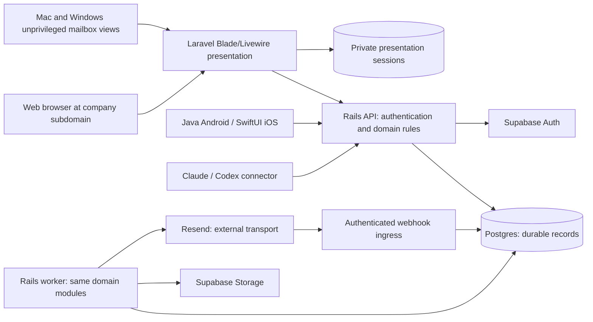
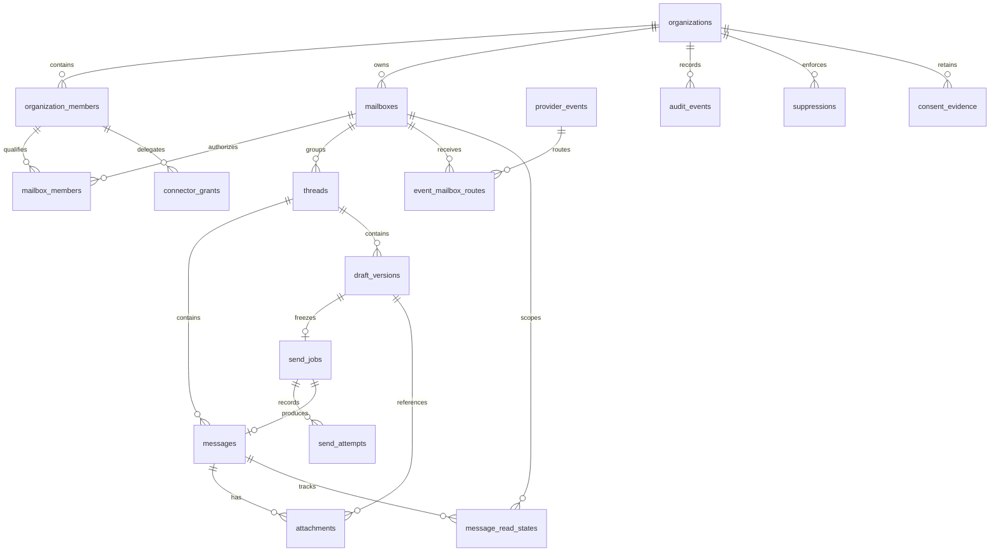

# Backend and database tutorial: a shared company mailbox

> **Design only — not implemented.** On 2026-10-13 the user selected Rails backend, Laravel Blade/Livewire presentation, self-hosted Supabase and Resend; see [ADR 0002](decisions/0002-rails-laravel-presentation.md). This tutorial does not establish completed consultations, production approval, migrations or an SLA. Nothing here implies that SMTP/IMAP hosting, desktop packaging or connectors already exist.

## 1. Start with a conversation, not a server

Imagine Maya and Leo both help customers through `support@company.example`. Maya opens a request from Alex, assigns the conversation to herself, and starts a reply. Leo opens the same conversation and sees Maya's draft. Maya approves a reply while Leo still has an older screen open. The system must prevent Leo from silently overwriting the draft or submitting a second copy of Maya's send. It must also recover if the mail provider accepts Maya's reply but the worker crashes before recording the response.

A third colleague, Priya, belongs to the same company but can access only `sales@company.example`. Priya must not see the support conversation, its attachments, search snippets, or delivery events. Company membership is necessary but insufficient: access to each mailbox is a separate permission.

These examples reveal the backend's real job. It preserves agreements about who may do what, which content was approved, and which external actions might already have happened. The UI is a view of those agreements. It is not their source of truth.

## 2. The proposed system and its boundaries

A **Rails modular monolith** keeps domain rules together in one codebase, divided into modules such as identity and access, mailboxes, conversations, sending, receiving, and auditing. Separate API and worker processes share these modules and their database while running independently. A thin Laravel presentation server renders Blade/Livewire UI and calls the Rails API; it adds a request hop and an operating responsibility, not a second mailbox backend.

The **API** handles short requests: loading conversations, saving drafts, checking access, and approving sends. The **durable worker** performs asynchronous work: dispatching sends, processing provider events, fetching received bodies, scanning attachments, and reconciling ambiguous outcomes. Durable means that pending work survives a process restart because its authoritative record is in the database. A worker's in-memory queue alone does not meet that requirement.

Laravel keeps encrypted per-user Supabase access/refresh material in its protected server-side presentation session store, with a host-only Secure/HttpOnly/SameSite cookie and CSRF checks. Rails verifies individual identity, current session/grants and mailbox membership on every protected call. Laravel owns only a separate restricted presentation-session schema/migration lane; Rails owns domain migrations and Supabase owns its internal schemas. A service identity cannot authorize a supplied user ID. Refresh rotation and logout/revocation require concurrency tests; do not expose tokens through Livewire state, HTML or logs.

Desktop remote mailbox views have no native privileges; a separate trusted bundled panel owns explicitly granted CLI capabilities. Blade requires the remote PHP server and is not an offline desktop bundle. See [the full diagram](architecture-diagram.md) for the connector and attachment-proxy boundaries.

**Self-hosted Supabase provides Postgres, Auth, and Storage capabilities; it is not SMTP or IMAP mailbox hosting.** Postgres stores relationships and transactionally durable state. Auth supplies identities and authentication sessions. Storage holds objects such as attachments and retained message bodies, with access policies and lifecycle rules. Self-hosting also creates responsibility for upgrades, backups, restore testing, security, and availability.

**Resend is the user-selected external send/receive transport.** It carries outbound email and exposes supported inbound email workflows. Current documented capabilities are verified in [mail delivery and hosting](mail-delivery-and-hosting.md); account access and real-domain behavior still require integration testing. Pairing Supabase with Resend does not automatically provide an IMAP account, SMTP submission service for arbitrary mail clients, existing-mailbox synchronization, calendar, or a complete Gmail replacement. Whether MX routing can serve the intended company inbox and coexist with existing mail is a delivery-design decision.

The web, Mac, Windows, and connector clients should use the same authorization and send rules. A desktop app must not receive a database service credential. A connector grant should express a limited user-delegated capability, such as reading support conversations or creating drafts; permission to draft does not imply permission to send. Desktop packaging and connector protocols belong in their separate design documents.

## 3. Learn the database vocabulary through the mailbox

A **table** stores one kind of fact. A row in `mailboxes` represents a mailbox; a row in `messages` represents a message's placement in that mailbox. A **primary key (PK)** identifies a row inside a table. An opaque generated ID is useful, but its unpredictability is not authorization.

A **foreign key (FK)** requires a reference to an existing row. A mailbox refers to an organization; a message refers to a thread. A **unique constraint** prevents two rows from claiming the same identity, such as two active membership records for the same organization and user. A **composite key** combines several fields. Its main value here is preventing relationships from crossing a tenant or mailbox boundary accidentally.

For example, give `threads` a unique candidate key `(organization_id, mailbox_id, id)`. A message's `(organization_id, mailbox_id, thread_id)` must reference that entire key. A foreign key on `thread_id` alone could identify a real thread while failing to prove that the message's declared organization and mailbox match it. Similarly, `(organization_id, mailbox_id)` must reference the corresponding mailbox candidate key, not merely any mailbox ID.

These constraints protect structural correctness even if application code makes a mistake. They do not prove that the requesting user is allowed to access the row. Constraints and authorization solve different problems.

An email address also needs deliberate normalization. Normalize domains according to the chosen address rules; do not casually remove dots, plus suffixes, or lowercase every local part as though all providers interpret them identically. Keep the original address for display and a documented comparison representation where needed. Uniqueness of a configured receiving address across organizations depends on routing ownership and must be resolved explicitly.

## 4. Conceptual relationships

The following diagram is a design map, not executable SQL. Auth users are managed by the identity system; application membership rows connect those identities to company and mailbox permissions. The dictionary below includes important constraints that a diagram cannot express.

### Proposed schema dictionary

Every table below is a proposal, not an implemented schema. IDs are opaque, timestamps use a consistent UTC representation, and external payloads are validated at ingestion. Mailbox-scoped rows carry both `organization_id` and `mailbox_id`; relationships between them use composite constraints. Provider-scoped ingress receipts are the restricted exception and gain mailbox projections through explicit routes. Status fields use a defined state vocabulary, not arbitrary strings.

| Table | What a row means and principal fields | Proposed relationships and invariants |
| --- | --- | --- |
| `organizations` | One company workspace: `id`, name, lifecycle state, created time. | PK `id`. Disabled workspaces cannot authorize new sends. Ten users is the planning scale, not a database capacity claim. |
| `organization_members` | One user's membership: `id`, `organization_id`, `user_id`, role, active/revoked state. | PK `id`; FK to organization and Auth identity; unique `(organization_id, user_id)`. Organization admin rights do not silently grant message access. |
| `mailboxes` | One application mailbox: `id`, `organization_id`, address, routing identity, state. | PK `id`; unique `(organization_id, id)` and documented organization/address uniqueness. External routing identity must have unambiguous ownership. No credentials in this row. |
| `mailbox_members` | One user's mailbox permissions: organization, mailbox, user, read/draft/send/manage capabilities, state. | Unique `(organization_id, mailbox_id, user_id)`; composite FKs to mailbox and `(organization_id, user_id)` organization membership. Both memberships must be active. |
| `threads` | One conversation **inside one mailbox**: `id`, organization, mailbox, team status, optional assignee, timestamps. | Unique `(organization_id, mailbox_id, id)`; FK to mailbox. Assignee must reference a mailbox member; active status requires a runtime check. Team status is shared, not a user's unread flag. |
| `messages` | One incoming/outgoing message placement: `id`, organization, mailbox, thread, direction, envelope metadata, RFC headers, content state, optional `send_job_id`, provider identity. | Composite FK to thread. A non-null send-job reference is unique and in the same mailbox. Provider identity uniqueness uses documented provider/account/mailbox scope. RFC `Message-ID` is indexed evidence, not a globally unique PK. |
| `draft_versions` | One immutable draft revision: `id`, organization, mailbox, thread, `draft_id`, version, author, recipients, content, attachment manifest, digest. | Composite FK to thread; unique `(organization_id, mailbox_id, draft_id, version)`. Revisions cannot be edited after creation. Approval points to one exact revision. A small additional `drafts` parent record is proposed to hold the current version and approval state. |
| `send_jobs` | One approved logical send, also the transactional outbox entry: `id`, organization, mailbox, draft-version reference, immutable snapshot and envelope, snapshot digest, stable send key, state, approval actor/time, first-attempt time, lease token/expiry. | Unique approved draft-version reference within mailbox and unique stable send key. Composite FKs preserve mailbox scope. Snapshot and envelope never mutate; operational state may. Application idempotency tombstone survives content deletion. |
| `send_attempts` | One reserved provider-call attempt: `id`, send-job reference, attempt number, lease fencing token, reserved time, completion time, outcome, provider ID if known, sanitized error. | Composite FK to job; unique `(send_job_id, attempt_number)`. Record reservation before I/O. A reservation without completion means the call might or might not have happened. |
| `provider_events` | One durably received provider-scoped delivery: `id`, provider/account context, delivery ID, optional business event ID, event type/time, received time, protected payload reference, processing/fetch state. | Unique `(provider, account_context, delivery_id)`. Raw receipts are restricted ingress data, not directly readable by ordinary mailbox members. One receipt can route to zero or many mailboxes; never trust a payload-supplied tenant ID. |
| `event_mailbox_routes` | One authorized projection/routing of an event into a configured mailbox: event ID, organization, mailbox, import state, resulting message ID. | Unique `(provider_event_id, organization_id, mailbox_id)`; composite mailbox/message FKs. Map trusted receiving identities to configured addresses. Expose only mailbox-specific content projections; raw multi-recipient event metadata can contain another mailbox's data. |
| `attachments` | One message or draft-version attachment reference: `id`, organization, mailbox, parent reference, storage object/version, checksum, size/type, scan state, retention state. | Exactly one parent type per reference; composite FK to its message or revision. Shared immutable blobs need a separate object/reference lifecycle. A send snapshot pins approved clean bytes, not a mutable upload URL. |
| `audit_events` | One security or domain action: organization, optional mailbox, actor type/ID, action, resource IDs, result, correlation ID, time. | Append-only through normal application paths; composite mailbox/resource references where applicable. Organization-wide events are separately restricted. Exclude bodies, tokens, and unnecessary recipient data. |
| `connector_grants` | One delegated grant: organization, mailbox, user, client identity, capabilities, expiry, revocation, hashed token identifier. | Proposed one row per mailbox scope; composite references to the user's organization and mailbox memberships. Effective permissions are the intersection of grant and current membership. No bearer secret stored in clear text. |
| `suppressions` | One prohibition on relevant contact: organization, optional mailbox scope, recipient comparison value, purpose/channel, reason, effective time, revocation evidence where legitimate. | Explicit organization-wide versus mailbox scope; composite FK for mailbox scope. Uniqueness must handle organization-wide rows deliberately rather than rely on nullable-key behavior. Dispatch checks all applicable scopes. |
| `consent_evidence` | One evidence record where required for the purpose: organization, subject/address, scope, purpose, source, captured time, evidence reference, withdrawal/expiry. | Evidence is append-only or superseded with history. Link sends to the evidence evaluated when applicable. Consent is not inferred from address verification or a prior successful send. |
| `message_read_states` | One user's read position for one message: organization, mailbox, message, user, read time. | Unique `(organization_id, mailbox_id, message_id, user_id)`; composite FKs to message and mailbox membership. This proposed supporting table separates personal read state from shared team workflow. |

Additional implementation design will be needed for `drafts`, durable fetch-task scheduling, business-event deduplication, and security-minimal idempotency tombstones. They are named here so that the dictionary is not mistaken for a complete migration specification. A dedicated `business_event_receipts` record can uniquely claim a provider business event while preserving every distinct webhook delivery in `provider_events`.

## 5. Authorization: two memberships, every access path

Authentication answers “which identity is making this request?” Authorization answers “may this identity read this support message or approve this reply now?” Supabase Auth helps with the first question. The application's access model must answer the second.

For an ordinary user, the proposed rule is: authenticated identity, active organization membership, active membership in the resource's mailbox, and the required capability. Drafting, sending, managing members, and reading need not be interchangeable. Maya and Leo pass the support checks; Priya fails even though she belongs to the company. Any administrator override must be explicit, narrowly scoped, and auditable.

**Row-level security (RLS)** restricts which database rows a caller can access using policies. Each mailbox-scoped table needs policies that check both memberships and the operation's capability. Write policies must constrain the resulting row as well as the rows selected for update; otherwise a caller might move a permitted record into a forbidden mailbox. Composite FKs are a second guard against such cross-scope relationships.

A privileged service role can bypass ordinary RLS protections. Ordinary API requests must instead use a restricted database role with verified user claims set transaction-locally, as specified in the architecture. A narrowly granted worker role handles background operations. Any necessary privileged helper is a reviewed exception with explicit scope/authorization, never a general request path. Privileged keys never go to web, desktop or connector clients. The worker still rechecks current authorization before dispatch; its technical access does not prove the user was entitled to send. See [PostgreSQL RLS](https://www.postgresql.org/docs/current/ddl-rowsecurity.html) and [Supabase RLS](https://supabase.com/docs/guides/database/postgres/row-level-security).

Apply the same rule to attachment downloads, search indexes, exports, realtime subscriptions, cached counts, audit views, and connector results. Storage paths containing an organization ID do not establish access. To enforce revocation on new downloads, use an authenticated API/proxy that rechecks current session/grant and mailbox access; keep any short-lived Storage signed URL server-side. Previously obtained application links must still pass that check. Already received bytes cannot be recalled. A cached search hit must not leak a support snippet to Priya after a membership change.

Revocation should stop new approvals and block queued sends whose approving actor no longer has the required access under the proposed policy. Serialize the final dispatch authorization decision with relevant membership/suppression changes in a short transaction. Once that transaction permits dispatch, a later revocation cannot guarantee cancellation of an already-starting external request. Define and audit that boundary; do not promise instantaneous recall.

## 6. Draft collaboration and immutable approval

A draft is editable work. An approved send is a fixed instruction. Keeping them separate avoids a dangerous race where the worker sends content that nobody approved.

1. Maya and Leo load draft `D`, currently at version 7.
2. Maya saves with expected version 7. In one short transaction, the API conditionally advances the `drafts` parent from 7 to 8 and appends immutable revision 8.
3. Leo saves with expected version 7. The condition fails. Return an explicit conflict with a way to inspect or merge the newer revision; do not overwrite it silently. A unique version constraint alone is not the full optimistic-lock protocol.
4. Maya approves revision 8. The API rechecks mailbox send rights, validates sender and recipients, verifies attachment readiness, and checks applicable suppression/consent policy.
5. In one database transaction, it records approval of that revision on the draft parent and creates the send job containing the exact approved sender, envelope, headers, body representation, and attachment manifest. The same transaction inserts the approval audit event. All three changes commit together or none does.

The snapshot distinguishes visible `To`/`Cc` headers from the actual recipient envelope, including confidential Bcc recipients. Persist a canonical recipient representation and the exact approved content or durable immutable references. Bcc must not leak into recipients' delivered headers or normal shared logs. Any address, body, or attachment change requires a new revision and explicit approval.

For this proposal, one approved revision maps to one provider send request and one immutable envelope. A stable opaque send identity is allocated at approval and bound to the snapshot digest and envelope. Include it as the immutable `elevateo_send_id` provider tag; signed webhooks can then correlate an accepted email even when the send response was lost. Verify account context and the unique job/tag mapping; do not match by recipient and time. [Resend documents webhook tag propagation](https://resend.com/docs/dashboard/emails/tags). It is not derived solely from content: two intentionally approved identical messages can be distinct sends. Repeated approval requests for the same revision return the existing job. A conflicting payload under the same application idempotency key is rejected.

If provider limits require splitting recipients into multiple requests, that is a separate design extension: assign immutable child envelopes and a distinct stable identity to each before dispatch, with partial-success semantics. Never change an existing job's envelope to retry only some recipients. User-requested resend is a new explicit approval, with visibility into the earlier send's uncertain or accepted state.

The application preserves a unique ledger or minimal tombstone for a send identity perpetually: the same logical send must never become “new” merely because its message body expired. Perpetual idempotency does not mean retaining full personal content forever. Tombstone fields, account deletion, and privacy requirements need an explicit retention decision; deleting every trace necessarily ends this guarantee.

## 7. Transactional outbox and the uncertain send

The send job doubles as a **transactional outbox**: the intent to perform external work is committed with the business decision that authorizes it. This closes the gap where approval succeeds but a separate queue publish fails. A queue notification may accelerate work, but polling committed jobs must be sufficient for recovery.

A proposed lifecycle is `queued → dispatching → accepted`, with alternatives such as `blocked`, `failed_definitive`, and `needs_review`. Delivery is tracked separately, preferably per recipient where provider evidence supports it. Accepted means the provider accepted responsibility; it does not mean the destination server received the message or that a human read it. A later bounce or complaint must remain visible.

A worker claims a job in a short transaction, assigns a lease expiry and increasing fencing token, and reserves an attempt. Before provider I/O, it durably sets `first_attempt_at` if absent. In that same dispatch decision, it checks current permission, mailbox state, suppression, snapshot integrity, and whether retry is safe. It then commits, releases database locks, and calls the provider using the job's stable provider idempotency key and unchanged payload.

**Do not hold a database transaction open across the network request.** The provider cannot join the Postgres transaction. Holding locks while waiting adds contention without making the external email reversible.

After the call, the worker opens a new short transaction to record acceptance, definitive rejection, or uncertainty. Its authoritative state update must match the current fencing token. A stale worker must not overwrite a newer owner's decision. Late observations can be retained as attempt evidence through a controlled path and reconciled rather than discarded or allowed to mutate the job freely.

### Two idempotency clocks

**Resend's documented idempotency window is 24 hours**, verified against [the official documentation](https://resend.com/docs/dashboard/emails/idempotency-keys) on 2026-10-11. This bounded provider protection is distinct from the application's persistent logical-send ledger. Test key scope, payload conflicts and endpoint behavior during integration; do not assume protection beyond the documented window.

Compute a conservative safe retry horizon from the durable first attempt, with a margin for clock uncertainty, scheduling, and request duration. Do not reset that timestamp on retries or lease renewals. An attempt reservation before I/O may precede actual provider receipt; using that earlier timestamp is conservative. Near or past the horizon, an unresolved send enters `needs_review` for reconciliation rather than being sent automatically again—even with the same key, which the provider may now treat as new.

The proposed application retry horizon is 23 hours from the first-attempt timestamp; maximum request duration and clock margin must be validated during implementation. A paused process can resume unexpectedly; a local lease or clock check cannot prevent all late external calls. Recheck immediately before I/O, bound request lifetime, stop obsolete workers where possible, and recognize that the provider does not enforce the application's fencing token.

| Failure point | Durable evidence | Proposed recovery |
| --- | --- | --- |
| API crashes before approval transaction commits | No committed approved job. | Client retries approval with the same identity; no worker should see uncommitted work. |
| API commits but response is lost | Approved job exists. | Retry returns that job rather than creating another. |
| Worker crashes before attempt reservation commits | Job exists without that reserved attempt. | Another worker may claim it; the crashed worker must never call without committed reservation. |
| Worker commits reservation, then crashes before calling | Reserved attempt and first-attempt time exist, but no completion. | Treat as potentially sent: reservation does not prove absence of I/O. Retry only inside the safe horizon using the same key and snapshot. |
| Provider accepts, response times out | Application cannot distinguish acceptance from no send. | Mark uncertainty; reconcile or retry the same key inside the safe horizon. Never allocate a new key automatically. |
| Provider accepts, worker crashes before recording acceptance | Same ambiguity, perhaps later webhook evidence. | Reconcile provider evidence; bounded same-key retry only while safe. |
| Provider returns a documented definitive rejection | Rejection recorded with sanitized reason. | Fail or block appropriately; distinguish documented no-acceptance failures from ambiguous network/server failures. Content fixes require fresh approval. |
| Lease expires while old worker is still calling | Two workers could reach the external provider. | Fencing protects database updates, not external I/O. Same-key provider protection helps within its contract, but does not prove exactly-once delivery. |
| Ambiguity remains after the safe horizon | Old reservation, no conclusive disposition. | Hold, inspect reliable provider history/events, and record a reconciliation decision. Absence of a webhook is not proof that nothing was sent. |

Leases plus provider keys are useful duplicate defenses, **not an exactly-once guarantee**. Database ACID covers local transactions, not external email side effects. Reconciliation may discover acceptance and link its provider message ID; if reliable evidence cannot settle the outcome, keep the uncertainty visible. An authorized person may decide to send a new message after reviewing duplicate risk, but that is a new auditable action, not an invisible retry.

## 8. Receiving mail without losing it

A webhook is a notification delivered over an unreliable network. It can arrive twice, late, or out of order. Treat it as untrusted input until signature/authentication, size, shape, and allowed event type have been checked. The specific verification and replay-tolerance rules must follow the provider contract; do not log secrets or entire bodies to diagnose signature failures.

For a valid event, the ingress handler commits a `provider_events` receipt and durable processing intent before returning a success acknowledgment. A uniqueness conflict on the delivery ID means that delivery already exists; it is safe to acknowledge after verifying the durable record. If the database cannot commit, do not acknowledge success: rely on provider retry and reconciliation. Do not wait for body retrieval or attachment scanning before acknowledging a committed receipt.

A **delivery ID** identifies a webhook delivery according to its provider contract. A **business event ID** identifies the underlying occurrence, such as acceptance of one provider message, and may appear in multiple deliveries. Preserve both. Deduplicate transport receipts by delivery ID, then claim business effects separately by business event ID when supplied. If no stable business ID exists, define a provider-specific semantic identity only after verifying its guarantees; a payload hash or timestamp alone is not a universal solution.

A replay reprocesses an existing durable receipt through a versioned handler; it does not pretend to be a new email. Store processing status, handler version, attempt information, and errors. Unique message/provider mappings and business-effect guards prevent duplicate conversations, attachments, and audit effects. Out-of-order events should add evidence without naively regressing state: a delayed acceptance must not erase an already recorded bounce.

An inbound event may contain only metadata and a retrieval identifier. In the receipt transaction, schedule durable body/attachment fetch work. The worker fetches outside database transactions, writes to quarantined storage using repeatable object identities, and commits validated references in another transaction. Orphan objects from a crash need a deliberate cleanup path. An expired download URL should be refreshed through the supported provider API where possible; finite provider retention means recovery cannot be postponed indefinitely.

Expose honest content states: `pending_fetch`, `quarantined`, `ready`, or `unavailable`. Acknowledging the webhook proves receipt of the notification, not preservation of the body. If retrieval repeatedly fails, alert and reconcile; do not manufacture a blank successful message. Proposed monitoring should include oldest pending fetch age relative to provider retention.

Email HTML and attachments are hostile content until processed. Disable executable content, sanitize HTML, isolate rendering, block remote content by default or use an explicitly designed privacy mechanism, validate actual file types and sizes, and scan attachments. Protect raw originals separately for support or evidence. Connectors must treat email text as data, never as permission to obey embedded instructions or disclose other messages.

Retention must cover raw webhook payloads, fetched originals, sanitized views, attachments, quarantine, audit metadata, backups, and idempotency tombstones separately. Define access, deletion timing, legal holds if applicable, and failure handling. Keep original evidence only as long as the agreed purpose requires; avoid duplicating bodies in unrestricted logs. Provider retention and local retention are separate contracts.

## 9. Threading and shared workflow

A thread is an application record scoped to a mailbox, not an RFC header value. The same email delivered to support and sales can legitimately create two mailbox placements and two thread records with different access rules. The RFC `Message-ID` may help correlate them, but can be missing, duplicated, malformed, or forged. Do not use it as a globally unique database identity.

For Alex's reply, inspect `In-Reply-To` and `References` against known message headers **within the routed mailbox**, considering participants and provider correlation evidence. A matching subject alone is insufficient: two customers can both write “Help.” A header match alone should not force a sensitive merge when evidence conflicts. Prefer a new thread or reviewable conservative association when uncertain, and make manual merges/splits authorized and audited. Duplicate delivery detection uses trusted provider receipt/message identity, not subject similarity.

Maya reading a message must not mark it read for Leo. `message_read_states` holds each person's state. Team status belongs to the thread: open, pending, or resolved, with an optional shared assignee. An incoming customer reply may reopen a resolved thread according to an agreed workflow while preserving individual read positions. A send acceptance can update activity; it should not silently assert that the customer received the answer or that the issue is resolved.

## 10. Transactions, ACID, and CAP without slogans

A database transaction groups changes into a local all-or-nothing unit. In ACID, **atomicity** prevents half an approval from committing; **consistency** means constraints and invariants remain valid; **isolation** governs concurrent transactions; and **durability** concerns committed data surviving failures within the configured storage guarantees. Transactions still require correct constraints, locking or conditional writes, and an appropriate isolation strategy. A default transaction alone does not eliminate every race.

CAP addresses a different question: what can a distributed system guarantee **during a network partition**, when components cannot reliably communicate? Its consistency means **linearizability**: operations behave as though they occur on a single up-to-date copy in an order compatible with real time. This is not ACID's meaning of constraint correctness. CAP availability means requests reaching nonfailed nodes receive the required response; refusing or indefinitely delaying a protected operation sacrifices that availability even if the UI remains online.

“Choose any two” is an inadequate blanket rule. A real network can partition; the system must decide which operations it will refuse rather than allow conflicting decisions. Outside a partition, latency, replication, and operational choices still matter. Running Postgres does not by itself establish a particular CAP guarantee for the whole application. See [Gilbert and Lynch's original CAP paper](https://www.comp.nus.edu.sg/~gilbert/pubs/BrewersConjecture-SigAct.pdf) for the formal model; the mailbox choices below are our application of that idea.

For permissions, approvals, suppression gates, and the send ledger, the proposal is one authoritative decision path through the primary database. If it cannot be reached, **fail closed**: do not authorize from a stale replica or dispatch based only on a cached job. A single primary simplifies serialization but is a single point of failure unless a tested recovery/failover design addresses it. Even with replicas, promotion, fencing, split-brain prevention, and replication durability need deliberate design.

For delivery-status projections, search indexing, unread counts, and UI refresh, **eventual consistency** can be acceptable. A stale view should display its last successful refresh and a stale/pending indicator rather than assert current delivery. These projections must still pass current mailbox authorization before disclosure. A stale status allowance is not permission to serve cached support content to a revoked member. An offline client may retain data already downloaded under a stated local-cache policy, but cannot obtain fresh authorization or approve a send until the authority is available.

For example, if Maya's UI cannot reach the database, she may keep an explicitly unsent local draft if the client supports it. She cannot receive a trustworthy “approved and queued” result. If the worker cannot reach the database, it cannot reserve a new attempt. If the provider is unreachable, the database may record a queued job, but the UI must distinguish queued from accepted. If the provider accepted before a partition, local rollback cannot retract that email.

## 11. Recovery goals must be measured, not assumed

**Recovery point objective (RPO)** is the maximum tolerable loss of previously durable data, expressed as time. **Recovery time objective (RTO)** is the target time to restore a defined service after an incident. Neither is an established SLA here. Self-hosting Supabase does not supply these objectives automatically, and a successful backup job is not proof of a successful restore.

Propose setting separate measurable goals for: (a) authorization and send ledger recovery, (b) messages and attachment availability, and (c) rebuildable search/status projections. The owners must accept numeric loss and downtime budgets before rollout. The implementation plan proposes a noncritical pilot tier and a tighter primary-mailbox tier; neither is a measured SLA. Measure RPO from the newest recovered committed records, and RTO from incident start to verified service restoration under the agreed definition, not merely database startup.

A future recovery exercise should restore Postgres and Storage consistently, check object references and memberships, reconcile provider effects since the recovered ledger point, and rebuild derived indexes. Stop dispatch during restore until potentially lost accepted sends have been reconciled. A restored backup can lose application tombstones while the external provider has already sent mail; blindly replaying old queued jobs, especially after 24 hours, defeats duplicate protection.

Backups, write-ahead-log recovery, replica promotion, object versioning, and off-host copies are candidate mechanisms to evaluate against the chosen goals. Restore tests must establish what is actually recoverable, who can operate recovery, how secrets are supplied securely without appearing in documentation, and how the UI communicates reduced service. No measured performance, cost, recovery time, or availability is claimed here.

## 12. Four practice exercises, with answers

### Exercise 1: the colleague in the wrong mailbox

Priya knows a support attachment's ID and is an active organization member. The attachment endpoint checks only organization membership. Is a composite foreign key enough to protect the download?

**Answer:** No. The FK proves the attachment belongs to a valid scoped parent, not that Priya may read it. Require active support mailbox membership and read capability at the authenticated download endpoint and applicable RLS/storage boundary. Keep upstream signed URLs server-side and deny a new download after revocation even if Priya retained the application link. Test attachment, search, and connector paths as well as the message endpoint.

### Exercise 2: two draft editors

Maya and Leo edit version 7. Maya saves version 8 and approves it. Leo's old browser saves different recipients, then retries Maya's approval request after a timeout. What must happen?

**Answer:** Leo's expected-version-7 save conflicts. It cannot change revision 8 or its approved snapshot. Retrying the same approval identity returns the existing job with its original envelope; a changed payload under that identity is rejected. Leo must resolve the conflict and obtain fresh approval for a new revision before a different send is possible.

### Exercise 3: the disappeared response

An attempt is reserved on Monday at 09:00, the provider may have accepted it, and the worker crashes. Recovery starts Tuesday at 10:00. Can another worker send using the same provider key because the database lease expired?

**Answer:** No automatic resend. More than 24 hours has passed since the first possible call, so the bounded provider protection cannot be assumed. Lease expiry permits ownership recovery, not duplicate-free external replay. Hold the job for reconciliation using reliable provider history/events. Record acceptance if proven; otherwise preserve uncertainty. Any new send requires an explicit informed decision and a new logical identity.

### Exercise 4: a partition and a repeated webhook

The primary database is unreachable. A stale replica says Maya can send, but her access was revoked just before the partition. A valid incoming webhook arrives twice. What can the system safely promise?

**Answer:** It cannot approve or dispatch from stale permission state. It must fail closed for send authority. It also must not acknowledge the webhook as durably received until an authoritative receipt can commit; provider retries and later reconciliation handle recovery. After recovery, the unique delivery ID prevents duplicate receipt effects, and business-event deduplication handles distinct deliveries of the same occurrence. Previously authorized stale UI projections may be labelled stale only where current disclosure policy permits them; stale authorization is not an access grant.

## 13. Open decisions and future verification

This file supplies an educational model, not a complete implementation specification. The following decisions remain open:

- Confirm actual mailbox count, aliases, existing history and migration/coexistence requirements; the current root documents use the roughly ten-person company-mailbox brief.
- Integration-test Resend inbound routing, retention, webhook identity, event ordering, recipient reporting and idempotency against the verified documentation and actual account. Provider behavior must not be inferred from mocks alone.
- Follow the scoped engineering baseline; finalize role permissions, administrator access, dispatch/revocation boundaries and delegated connector capabilities through the pending design reviews, without reinstating blanket approval for already-authorized local work.
- Specify exact supporting-table constraints, draft-head concurrency, canonical snapshots, stable send keys, business-event guards, lease fencing, retry margin, and reconciliation operations.
- Define organizational versus mailbox suppression precedence, purpose-specific consent needs, retention/tombstone policy, quarantine handling, and local desktop cache behavior. Ordinary customer support and marketing must not silently share one consent assumption.
- Set numeric RPO/RTO goals and a backup/failover design; test recovery without duplicating already accepted sends.
- During local implementation, test cross-mailbox attacks, stale writes, duplicate/reordered webhooks, body-fetch expiry, crash boundaries, late workers, bounded-key expiry, and restore replay in Docker. Validate the real UI's conflicts, pending states, stale labels, and unknown-send warnings before any publication.

No Elevateo application tests or UI checks can establish these guarantees yet because this database model remains unimplemented. Imported upstream source and provenance-tool tests are separate from product acceptance. [The local completion brief](../LOCAL_BUILD_PROMPT.md) now governs implementation; this tutorial itself introduces no migration, installed package, provider call, or deployed service.
