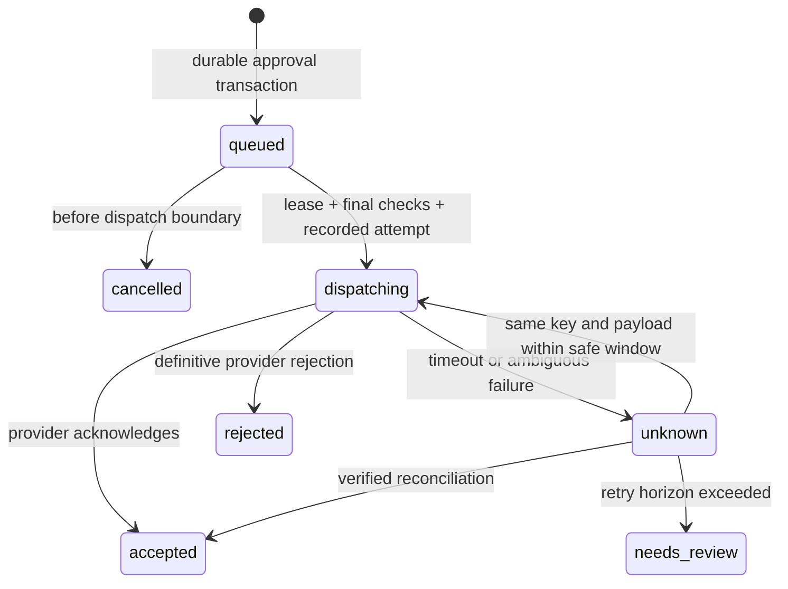

# API contracts and failure recovery

Status: design specification; none of these endpoints or jobs are implemented. Reconciled with accepted initial ADR 0002 on 2026-10-12.

## API conventions

Use `/v1`, strict boundary schemas, bounded page sizes, opaque keyset cursors and stable error codes. Every resource query includes verified organization **and mailbox** scope. A missing or inaccessible object returns a non-enumerating response; authentication failures remain 401. Request IDs correlate logs without including email bodies, tokens or sensitive headers.

| Proposed route | Required ability | Contract |
| --- | --- | --- |
| `GET /v1/mailboxes` | authenticated membership | Only mailboxes currently visible to the user |
| `GET /v1/mailboxes/:id/threads?cursor=...` | mailbox read | Stable cursor, bounded result count, team status and per-user read state |
| `GET /v1/threads/:id` | mailbox read | Authorized thread and safe content representation |
| `POST /v1/mailboxes/:id/drafts` | draft write | Validated envelope/body; version 1 |
| `PATCH /v1/drafts/:id` | draft write | Future accepted direction: expected_version; stale write returns 409 draft_conflict (mutation schema remains pending) |
| `POST /v1/drafts/:id/send` | human send + mailbox send | Immutable version and request idempotency key; returns 202 plus job ID |
| `GET /v1/send-jobs/:id` | mailbox read | Authoritative queued/accepted/unknown/delivery facts |
| `POST /v1/send-jobs/:id/cancel` | human send | Cancels only before dispatch authorization; returns conflict if too late |
| `POST /v1/webhooks/resend` | valid provider signature | Raw-body verification, durable insert, then 2xx; no user cookie |
| `POST /v1/connector-grants/:id/revoke` | grant owner/admin | Immediate grant revocation and audited event |

`202` means the job is durably queued, not delivered. A duplicate idempotency key with the same immutable payload returns the same job. The same key with a different payload returns conflict. Hashes and keys are scoped to organization + mailbox + actor/action where appropriate. Atomically consume the draft send intent exactly once and enforce one send job per draft: two devices using different request keys still receive the same logical send. Version uniqueness alone is insufficient. An intentional resend requires a new explicitly cloned draft and human approval. Retain application-level send identity independently of provider key expiry, including tombstones needed to prevent replay after retention cleanup.

## Example send command

Illustrative JSON, not a supported API today:

```json
{
  "draft_id": "draft-uuid",
  "expected_version": 4,
  "client_request_id": "unique-user-action-uuid"
}
```

The server derives sender identity from the authorized mailbox. It freezes recipients, subject, body, relevant headers and attachment digests/versions into the send snapshot. Do not let a worker re-render an edited draft, regenerate a time-dependent signature or read a replaced attachment while retrying the same identity. Persist an opaque `elevateo_send_id` in the immutable provider tags before the first call. Resend documents that tags appear in webhook events. Validate the signed event, provider account and unique job/tag association before recording its provider email ID. Keep the tag identical across attempts; an attempt counter would change the retry payload. If no matching event or saved provider ID exists, retrieve-by-ID cannot resolve the gap: use bounded same-key recovery or preserve uncertainty, never recipient/time heuristics. See [Resend tags](https://resend.com/docs/dashboard/emails/tags).

## Sending state machine



Delivery/bounce/complaint facts are separate from this dispatch state and may arrive before the API response is persisted. Preserve event history and merge facts; never downgrade a known acceptance because an earlier event arrived late. Store per-recipient delivery outcomes where supplied: a multi-recipient submission has one immutable envelope but does not prove delivery to every recipient. Avoid equating `opened` with verified human reading.

### Transaction boundaries

1. In a short transaction, validate membership, mailbox status, draft version, sender identity and permission/consent applicable to the message type. Atomically consume the draft and insert snapshot + job + audit under the one-intent-per-draft rule above and stable send identity.
2. Worker claims a due row using row locking/`SKIP LOCKED`, lease expiry and increasing lease generation. Record the first possible provider-attempt time **before** network I/O. Commit.
3. Immediately before dispatch authorization, recheck current mailbox access/disabled state, suppression and cancellation in a transaction. Commit a dispatch boundary; the UI must explain cancellation is no longer guaranteed after this point. A later revocation cannot recall a message already crossing the external boundary.
4. Call the provider with a bounded timeout, the same immutable payload and stable idempotency key. Never keep a DB transaction open across the call.
5. Append authenticated, attempt-correlated provider observations even when the originating lease expired. Only a fresh, generation-checked reconciler may update the authoritative projection. A stale worker cannot overwrite a newer owner, and its delayed acceptance evidence must not be discarded.

Provider idempotency lasts **24 hours**. Use a shorter application retry horizon (proposed 23 hours from persisted first attempt), accounting for clock skew, provider timeout and lease duration. Recheck the deadline immediately before every external call. No new automatic request after this boundary; escalate unknown state. Exactly-once internet email is not guaranteed. Application uniqueness, fencing and provider idempotency reduce duplicate risk within defined limits. A suspended worker cannot be perfectly fenced at the provider using a database generation number; bound worker lifetime/timeouts and prefer uncertainty over duplicate sending.

## Failure matrix

| Fault | Expected behavior | Required test |
| --- | --- | --- |
| Two browser clicks | Same durable job returned | Concurrent same-key requests yield one job |
| Two workers claim | One lease owner at a time | Concurrent PostgreSQL transactions |
| Worker dies before provider I/O | Resume same identity; do not mark sent | Crash after intent commit |
| Provider accepts; response lost | Unknown, reconcile/retry same key in window | Fake provider accepts then times out |
| Worker dies after response before commit | Recover provider evidence, no fresh key | Acceptance persisted by webhook/retrieval |
| Unknown beyond safe window | Hold for review; no automatic resend | Advance fake clock past boundary |
| Suppression or mailbox disable before dispatch | Cancel/hold without provider call | Race at final dispatch check |
| Suppression after dispatch boundary | Stop future sends; report already-dispatching item honestly | No false recall guarantee |
| Duplicate/reordered webhook | One imported event effect; monotonic known facts | Replay same event and reorder sequence |
| DB unavailable during webhook | Non-2xx, provider retry; alert | Do not acknowledge unpersisted work |
| Body retrieval fails after webhook accepted | Persistent import job retries/backfills | Metadata survives API outage |
| Stale lease owner finishes | Preserve authenticated correlated observation; cannot overwrite projection | Generation mismatch followed by fresh reconciliation |
| App restarts with `dispatching` rows | Reconcile; never reset all rows blindly | Crash/restart fixture |

## Receiving and threading

Webhook signature verification must use the exact raw body with replay-time tolerance and an explicit payload limit. Deduplicate on `(provider account, provider delivery/event ID)` as documented by the provider. A transport retry identity and a logical email ID are distinct: also enforce the appropriate unique import key for an email delivered to a specific mailbox. Receiving the same email for two authorized company addresses can create two mailbox-visible records without granting either mailbox access to the other.

Persist event + import job atomically before acknowledging. Route only from authenticated provider envelope facts; untrusted MIME To/Cc headers cannot select a mailbox. Unknown recipients go to a restricted quarantine, not a newly created public mailbox. Fetch body/headers separately, and retrieve fresh signed attachment URLs just in time. Bound bytes, time, redirects and allowed download origins. Do not fetch links embedded in the email. Scan attachments before release. Display message content as plain text, never HTML, and make no external image requests. Keep original content separately for authorized diagnostics; never inject it into the application DOM.

Match replies using References/In-Reply-To and stored RFC Message-IDs within the relevant mailbox. Validate header lengths and malformed values. Message-ID is untrusted external input and is not a globally authoritative primary key. Subject matching alone is insufficient; uncertain matches start a new thread or enter review. Prevent an external sender from joining private threads merely by guessing an ID; require compatible participants and mailbox routing.

## Outbox and reconciliation

A database outbox is the job/intent record committed with the domain change. It is not an additional network broker. Polling a modest indexed due-job table is adequate to pilot 10 users; the actual workload, not user count alone, determines capacity. Index pending rows by due time, and use bounded batches/backoff. Separate inbound imports from outbound sends so a large attachment cannot starve sending.

Run periodic reconciliation with provider list/retrieve endpoints, persisted cursors, overlapping windows and deduplication. Provider retention and API limits are external constraints; fetch promptly, monitor oldest incomplete item and alert well before the verified retention window. Manually resolving an unknown send requires evidence, actor, reason and audit. A decision to resend after ambiguity creates an explicit new send with a visible duplicate risk, never a silent state reset.

## Acceptance before live email

Demonstrate these failure cases with real PostgreSQL transactions and a deterministic fake provider. Then validate provider sandbox/test events and a controlled send/reply with owned addresses. The local fake must model provider key expiry and ambiguous acceptance; a mock that always succeeds does not validate this design.

Primary reference: [Resend idempotency keys](https://resend.com/docs/dashboard/emails/idempotency-keys), checked 2026-10-11. Further provider constraints are in [mail delivery and hosting](mail-delivery-and-hosting.md).

## Restore dispatch boundary

Keep a default-held dispatch control outside the restored application database. Restoring a backup cannot release outbound work. Reconcile preserved simulator/provider acceptance observations against restored send identities before an explicit operator release; expired or unresolved outcomes remain needs_review. The simulator acceptance ledger also lives outside the application backup target.
