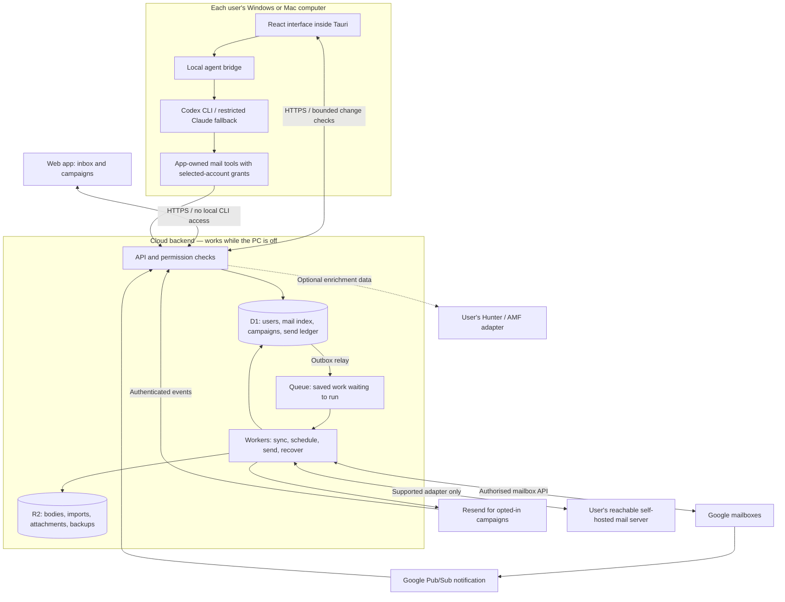

# Elevateo Mail — product master plan

**Planning draft · 4 October 2026.** The frontend prototype exists. The desktop app and backend are not built. This proposes the next direction; it does not approve implementation.

**Recommendation:** share the React interface between a web app and lightweight Windows/macOS desktop apps, backed by one small cloud backend that keeps approved campaigns working while the computer is off. Connect existing Google inboxes first, then a specifically tested self-hosted provider. Hunter and AMF provide optional enrichment data; AI performs personalisation. Keep paid services and background work to a measured minimum.

Reader edition: [PDF master plan](../output/pdf/elevateo-mail-master-plan.pdf), with fresh [frontend](../output/imagegen/elevateo-mail-frontend-sketch.png) and [architecture](../output/imagegen/elevateo-mail-system-design.png) sketches. These are proposed designs, not implemented screenshots.

Platform scope update: the [distribution PDF addendum](../output/pdf/elevateo-mail-distribution-plan.pdf) extends the earlier Windows-focused PDF and drawings to web, Windows and macOS. Desktop AI stays local; the initial web app has no local CLI bridge. Section 11 below records this change.

## 1. What we are building

| Confirmed requirement | Product consequence |
| --- | --- |
| Ten completely separate users | Private mail, contacts, campaigns, credentials and AI sessions. No shared inbox/team features. |
| Different organisations and personal Gmail | Connect through Google authorisation; never collect Google passwords. |
| At most 30 outgoing emails per connected mailbox per day | Enforce in the backend across campaigns, manual sending and AI actions; aliases share the mailbox allowance. |
| Up to ten mailboxes per user | Effective pilot maximum 300/user/day. The earlier 600/user/day ceiling requires a later mailbox expansion. |
| Personal inbox and campaigns | Read, reply, compose, organise mail, prepare sequences and handle replies. |
| Web app plus installed Windows and macOS apps | Shared inbox/campaign UI and backend; native window, taskbar/Dock presence and notifications on desktop. |
| Local Codex; Claude fallback | Each user signs into their own CLI account. AI runs on demand. |
| Campaigns continue with the PC off | Approved messages and schedules are saved in the cloud before activation. |
| Manually add all three kinds of email data | Connect mailboxes, add/import recipients, import historical messages. |
| Private Connections area | Each user supplies their own provider access; capabilities say whether a connection receives, sends or both. |
| AI reads selected mailboxes and drafts | Sending is separately enabled and approved; MCP cannot bypass normal permissions or limits. |
| Manage explicitly approved subdomains | Isolated DNS service, exact permitted records, change preview and human approval; preserve company root mail routing. |
| Hosting below A$15/month | Explicit storage/usage allowances; separate provider and subscription costs. |

The pilot allows **up to 10 connected mailboxes per user: 100 total**. At 30 per mailbox, this permits at most **300 outgoing recipient deliveries per user/day, 3,000 total/day** under the proposed counting rule. The earlier 600/user ceiling is a later expansion scenario, not achievable within the pilot allowance. The prototype's nine sender addresses are fictional fixtures, not a production limit.

Interpret “30 maximum” in the daily context of this discussion. Proposed counting rule: a rolling 24-hour window, with each recipient delivery counting once, including To/CC/BCC. One mailbox allows at most 30/day; three allow 90/day. Reaching the earlier 600 ceiling would require 20 distinct authorised mailboxes, which is arithmetic, not a recommendation to create accounts. The app cannot prevent sends made outside it.

**Section review:** mailbox count is settled. How far back should searchable history go, and how much imported attachment storage should each person have?

## 2. Learn system design through one action

**System design** describes who does each job and how the parts communicate. **Backend architecture** describes how server code is divided and protects data. A professional plan connects six things:

1. **Action:** “Pause my campaign.”
2. **Rule:** stop messages not yet authorised for dispatch; a request already handed to a provider may still complete.
3. **Contract:** return the saved status and explain sends already in progress.
4. **Data:** store campaign version, status and send history.
5. **Failure:** if the connection drops, reload saved status instead of guessing.
6. **Proof:** test pause during dispatch, duplicate requests and reconnect.

Apply that process to each feature before choosing services. The [engineering blueprint](backend-blueprint.md) makes the rules precise for implementation agents. [C4's diagram guide](https://c4model.com/introduction) introduces drawing a system at different levels of detail.

## 3. Proposed architecture



The database is the saved record of what should happen. The queue delivers work and may deliver a job twice. Workers must recognise work already processed.

| Part | Proposal | Why |
| --- | --- | --- |
| Web and desktop | Shared React/TypeScript; Tauri 2 on Windows/macOS | Reuse the interface; measure actual CPU/RAM on each OS before accepting the shell. |
| Cloud code | Cloudflare Workers, TypeScript | Small workloads without an always-running server. |
| Structured data | Cloudflare D1 | Affordable starting point with explicit storage/write limits. |
| Files | Cloudflare R2 | Keep large email content out of database rows. |
| Background work | Cloudflare Queues + scheduled Worker | Sending, imports and recovery survive desktop shutdown. |
| App sign-in | Google sign-in, separate mailbox permissions | Avoid another password/recovery system; settle MFA requirements. |
| Monitoring | Our health screen + provider logs | Operational visibility without hosting a monitoring platform. |

**Message bus:** use a durable work queue. Redis, Kafka, RabbitMQ, microservices and a search cluster have no demonstrated need at this size. Keep one backend codebase with clear modules.

D1 is conditional on measured fit. Its paid database ceiling is 10 GB and a database executes queries serially. PostgreSQL is a funded migration option if storage, search or writes outgrow this design; it is not a drop-in replacement. [D1 behaviour and limits](https://developers.cloudflare.com/d1/reference/faq/)

## 4. Email connections and reputation

**Preserve company root MX records.** Gmail API sync needs no MX change. AI and mail workers receive no DNS credentials. A separate DNS service may apply a human-reviewed change only to explicitly approved subdomain records. Cloudflare's token can still have wider zone access: an app restriction does not make the credential subdomain-only. Prefer manual owner changes until that risk or a provider-enforced boundary is agreed. The CTO messages are reported context, not independently verified DNS evidence. Do not repoint the reportedly existing `in.elevateoco.com` setup. [DNS design and provider limits](connections/security-plan.md)

| Service | Role |
| --- | --- |
| Gmail / Workspace | Existing inboxes, incoming mail, replies and authorised mailbox sending. |
| Resend | Confirmed campaign sending choice for opted-in clients, using verified sender domains and each user's own credentials. Google still supplies personal inboxes. |
| Self-hosted mail | A tested JMAP/HTTPS adapter first; IMAP/SMTP requires a separate compatibility and cost check. A desktop-only connection cannot run while the PC is off. |
| Hunter / AMF | Optional contact/company enrichment data. Exact AMF product/API still needs identification. Neither performs AI personalisation, establishes consent or blocks ordinary inbox/sending work. |
| Codex / Claude | AI personalisation and drafting, using permitted mail context and available enrichment; sending remains separately authorised. |
| EmailGuard | Optional verification/deliverability information, never an inbox-placement guarantee. |
| Instantly / Smartlead | Later campaign execution adapter. Each campaign has one scheduling authority. |

Resend prohibits unsolicited mail and purchased/scraped lists. Finding or validating an address does not create consent. Record permission and purpose, include unsubscribe, and stop on opt-out, complaint or hard bounce. [Resend acceptable use](https://resend.com/legal/acceptable-use)

The 30/day mailbox cap applies even when Resend sends the campaign. Every sender identity must map to a connected, authorised mailbox; aliases and reconnects do not reset the allowance. Provider limits can reduce it further. Reserve capacity for personal mail and never rotate accounts to bypass restrictions. Consumer Gmail also has its own sending restrictions. [Google sending limits](https://support.google.com/mail/answer/22839)

Resend cannot generally send as a personal `@gmail.com` address, because the user cannot verify ownership of `gmail.com`. Those accounts can use authorised Gmail sending within our cap; Resend campaigns require an owned, verified domain. Replies should return to the connected, authorised receiving mailbox, using an explicitly configured Reply-To where appropriate. A sending-only Resend key cannot read mail or reconcile outcomes through read APIs; plan the required authenticated event/recovery path explicitly. [Resend verified domains](https://resend.com/docs/dashboard/domains/introduction), [connection capabilities](connections/product-plan.md)

Use approved identities and appropriate SPF/DKIM/DMARC. A separately approved marketing domain/subdomain can reduce risk, but cannot guarantee reputation isolation. Accepted, delivered, bounced and replied are different facts; do not invent open rates. [Google sender guidance](https://support.google.com/mail/answer/81126)

**Launch gate:** unrelated organisations/personal Gmail require planning as an external application. Hosted access to restricted Gmail data requires verification and applicable security assessment unless a documented exception applies. Ten users alone do not establish an exemption. Testing-mode mailbox grants expire after seven days, so that is unsuitable for unattended production. Establish assessment cost/timing before committing to launch. [Restricted-scope verification](https://developers.google.com/identity/protocols/oauth2/production-readiness/restricted-scope-verification), [testing audience rules](https://support.google.com/cloud/answer/15549945)

## 5. Frontend additions

Keep the sketches' direction and extend the existing prototype:

```text
Search all my mail                         Sync status · Profile
---------------------------------------------------------------
Compose       | Mail list              | Conversation
Inbox         | Account / unread /     | Sender and account
Campaigns     | campaign filters       | Messages and attachments
Contacts      |                        | Reply / draft with AI
AI Assistant  |                        |
Connections   |                        |
Activity      |                        |
Settings      |                        | Saved / queued / failed
```

Add connect/reconnect screens, import progress, restart-safe drafts, explicit sender selection, offline/stale-data indicators and a visible campaign pause control. A failed connection must not look like an empty inbox.

Campaign creation: **recipients → consent check → content → schedule → review → activate**. Preview personalisation, explain blocked recipients, show the approved version and surface uncertain sends.

AI chat shows accessible accounts, proposed changes, a reviewable draft and a distinct approval action. Settings include private API keys, CLI health, resource limits, notifications, storage, export and removal. Every screen needs keyboard access and useful empty/loading/error states.

Connections has five clear areas: **mailboxes, sending services, AI access, enrichment, domains**. Show supported actions, last successful sync, remaining allowance, reconnect and revoke. Credentials are entered through secure forms, never AI chat. Domain changes show exact before/after records and consequences. [Connections plan and implementation contracts](connections/README.md)

Original references: [product wireframes](references/preliminary-product-wireframes.png), [backend sketch](references/preliminary-backend-architecture.png). Their labels are preliminary proposals, not instructions to configure services.

## 6. AI and desktop performance

The agent prepares content; backend code enforces permissions and sends approved work. A local CLI subscription is not a cloud AI service when the PC is off.

Keep the stages separate: optional Hunter/AMF enrichment supplies facts; AI personalisation turns permitted facts and user instructions into a draft; human review approves the content; the backend schedules and sends it. Store the source and age of enrichment, show missing facts, and do not invent details when enrichment is unavailable. Neither enrichment nor generated copy proves recipient consent.

Local CLI does not mean local AI processing: selected message content can be sent to OpenAI or Anthropic. User permission alone is insufficient: check the actual subscription's data terms against Google's user-data rules before enabling mailbox context. Keep that feature off until resolved. Never send whole inboxes by default.

Use one active CLI task, bounded input/output, cancellation, deadlines and process cleanup. No local model inference or constant AI polling. Cache recent mail, fetch bodies/attachments on demand, and reduce refresh work while minimised.

Tauri permissions do not sandbox a spawned CLI. Use a verified Codex Windows sandbox and narrow app actions. Claude's native Windows shell is not equivalently sandboxed: initially allow a tools-disabled drafting fallback; broader execution requires separately verified isolation. No automatic privilege escalation on fallback. [Codex Windows sandbox](https://learn.chatgpt.com/docs/windows/windows-sandbox), [Claude sandbox limitations](https://code.claude.com/docs/en/sandboxing)

The later mail-reading MCP mode exposes only Elevateo Mail's selected-account tools. It must prove that other tools, hooks and inherited connectors cannot run before it is enabled. AI may guide connection setup; it never handles provider passwords or grants itself access.

Proposed measurements on the user's hardware: under 1% average idle CPU, under 250 MB visible/150 MB tray memory for the full app/WebView2 process tree, interaction feedback within 100 ms. These are targets, not measurements. Measure CLI children separately and combined. Normal rendering can use the GPU; zero GPU activity is not a promise. Sandbox and tools-disabled fallback must pass negative tests on pinned CLI versions; no single flag is assumed to provide isolation.

## 7. Cost and optimisation

Propose **50 GB total cloud file storage including backups**, with the database below its included 5 GB. Illustrative base: **US$5 Workers + US$0.60 R2 = US$5.60/month**. At assumed US$1 = A$1.70 plus illustrative 10% tax: **about A$10.47**, before usage overages and other services. With all 100 pilot mailboxes checked every five minutes and sending their maximum, illustrative queue overage adds about A$1.39: **A$11.87 before notification-driven work, retries and other overages**. This is a scenario, not a live quote or guarantee; idle mailboxes should need less work. Storage allowances still need agreement. [Workers](https://developers.cloudflare.com/workers/platform/pricing/), [D1](https://developers.cloudflare.com/d1/platform/pricing/), [Queues](https://developers.cloudflare.com/queues/platform/pricing/), [R2 pricing](https://developers.cloudflare.com/r2/pricing/)

Mailbox subscriptions, sending/enrichment/validation, AI subscriptions, domains, Windows signing and any required Google assessment are separate costs. Unlimited history/attachments will not fit. Billing alerts are not hard caps. At 200 active mailboxes—the number needed for the earlier 6,000/day ceiling under the new cap—one illustrative polling model already raises hosting to about A$15.41 before other overages. The blueprint shows the assumptions. Under A$15 remains a goal requiring a measured mailbox/storage allowance, not a guarantee at maximum load.

For speed: fetch one page at a time, index real queries, batch imports, avoid repeated database reads and keep AI outside sending. The pilot's 3,000 sends/day averages only 0.035/second; bursts, syncing and stored history still need testing. Fair per-user limits stop one import blocking others. Correctness and permission checks stay ahead of speed.

Efficiency is a release requirement at every level: few deployed services; notifications plus bounded recovery instead of constant polling; metadata before bodies; small queue messages; indexed queries; no repeated full-inbox scans; one on-demand AI process. Measure monthly work and p95 latency together. Queue batching can reduce overhead but does not make individual messages free. Defer cosmetic analytics and optional enrichment before slowing critical receipt capture or weakening safety checks. The [efficiency plan](efficiency-plan.md) defines the cost controls and measurements.

## 8. Focused tests and monitoring

Use existing Vitest/Playwright, fake providers and local Worker storage inside Docker. Run lint, typecheck, unit/integration checks and important GUI journeys without paid API calls. Test duplicate jobs, timeouts, expired tokens, lost notifications, isolation and unsubscribe races. Use local load tests; avoid a test for every trivial implementation detail.

Windows installation, WebView2, taskbar/tray and notifications need a small native-Windows check because Linux containers cannot reproduce them. Fake APIs do not prove live compatibility: include an authorised real-account smoke test before release. Zero incremental test-service spend is feasible with existing eligible Docker/build resources; hardware, electricity and commercial licences are not automatically free.

Our health screen shows last successful sync, queue delay, failed/unknown sends, provider errors, quotas and storage. Keep logs structured/redacted. An independent heartbeat check must detect a dead backend; a dashboard inside a dead app cannot alert. Use modest retention and a selected free/within-budget alert destination. Reconsider Sentry if crash diagnosis becomes costly.

## 9. Repository and build order

Proposed destination after deliberate migration; retain the working prototype until then:

```text
apps/web/           Browser entry point and browser-only services
apps/desktop/       Small Tauri host and desktop-specific services
apps/backend/       API, scheduler and queue handlers
packages/ui/        Shared React screens, created when both clients exist
packages/domain/    Pure mail, consent and campaign rules
packages/contracts/ Shared request/response schemas
packages/providers/ Gmail, Resend, optional adapters
infra/              Cloud configuration and database migrations
tests/              Provider fakes, integration, GUI and load checks
docs/               Product plan, blueprint, decisions and research
.planning/          Standards and current state
```

Use strict types, boundary validation, a lockfile, migration history and one typed configuration module. Keys never enter frontend bundles. Each module has one job. Fix the prototype's direct-store mutations before real backend actions. Create workspace packages only when a second application actually shares them; do not create empty scaffolding or universal provider abstractions in advance.

Build in order: **(1)** settle Google approval/backend standards, **(2)** connect one mailbox, **(3)** prove sending/sync/recovery with two isolated users, **(4)** add approved campaigns and PC-off operation, **(5)** desktop/AI bridge, **(6)** ten-user load/cost checks, then optional integrations. Each step has exit checks in the blueprint.

## 10. Section-specific decisions

| Section | Remaining decision |
| --- | --- |
| Storage | 10 mailboxes/person confirmed; history age, import allowances and proposed 50 GB total storage remain open. |
| Identity | Google sign-in sufficient? Enforced MFA needed? |
| Sending | Approved sending accounts/providers; actual recipient consent records. |
| Daily cap | Confirm the proposed rolling 24-hour, per-recipient counting rule for the 30-per-mailbox limit. |
| Integrations | Exact AMF product; optional EmailGuard behaviour; other campaign platforms can wait. |
| Self-hosted mail | Name one server/API and confirm whether it is reachable while the desktop is off. |
| DNS | Exact owner-approved subdomains/record types and acceptable provider credential scope. |
| Launch | Applicable Google verification/assessment path and budget. |
| Data | Regions, retention, export/deletion and recipient jurisdictions. |
| Engineering | Review [draft backend standards](../.planning/BACKEND-STANDARDS.md) by section before implementation. |

Research is complete: the initial three GPT-6.1 Sol low-effort agents and three independent Claude CLI sessions, followed by ten connection/efficiency assignments. The ten ran in waves because this session permits only three simultaneous child agents. Evidence, limitations and section-targeted reviews are in the [research index](research/2026-10-04/README.md). Research supports decisions; this plan and approved standards govern implementation.

## 11. Distribution: web, Windows and Mac

Confirmed addition: provide a browser version and directly downloadable Windows/macOS apps. No store listing is planned. This is a distribution proposal, not an available download or approved implementation.

- One HTTPS website offers Open web app, Download Windows and Download Mac. Publish installers separately from the private source repository; users do not need GitHub access. A Cloudflare static site plus R2 download storage is the proposed hosting route, subject to the total usage budget. No domain or DNS changes are made during planning.
- Windows: signed NSIS `.exe` installer by default; offer `.msi` only if managed company deployment needs it. macOS: Developer ID signed and notarized `.dmg`, with separate Apple Silicon and Intel builds only for architectures we test. Native install/update checks require actual Windows/macOS resources.
- Share screens, business rules and one cloud backend. Keep browser and desktop platform services separate. The desktop loads packaged interface assets; a remote webpage does not receive native CLI privileges. Both clients enforce the same permissions, consent rules and mailbox quotas at the backend.
- Browser users can read mail and manage approved campaigns. A normal webpage cannot directly launch Codex/Claude CLI; a PWA installation does not change that. Initial local AI is desktop-only, using the user's installed and authenticated CLI. A browser-to-local helper would be a separate, explicitly paired feature with its own security review. Do not silently substitute a paid cloud AI service.
- Approved, fully prepared campaigns run in the cloud while the device is off. New local-AI work waits for the desktop to be available. Browser notification behaviour depends on browser/OS permissions and background support; do not promise desktop-equivalent closed-browser notifications before testing.
- Use Tauri signed updates over HTTPS, independent of OS code signing; protect and back up signing keys. Publish versioned artifacts first and update metadata last. Test wrong signatures, interrupted updates, old-client API compatibility and preserved user data. Schedule update checks sparingly and defer installation during active work.
- Budget Apple Developer Program membership (currently US$99/year, regional pricing applies), Windows signing, build runners and real-device testing separately from the A$15/month hosting target. Windows signing establishes publisher identity but does not guarantee absence of SmartScreen warnings. Mac packaging needs a macOS build environment; Windows Docker checks cannot prove Mac behaviour.

**Section review:** before release, choose supported OS versions/architectures, name the signing owner, confirm access to a Mac test/build environment and settle notification expectations. Extend backend/desktop standards with OS-specific credential storage, CLI discovery, sandbox verification and OAuth return handling before implementation.

Primary references checked 4 October 2026: [Windows installers](https://v2.tauri.app/distribute/windows-installer/), [Mac DMG](https://v2.tauri.app/distribute/dmg/), [Apple Developer ID](https://developer.apple.com/developer-id/), [Apple membership](https://developer.apple.com/help/account/membership/program-enrollment/), [Windows signing](https://v2.tauri.app/distribute/sign/windows/), [signed updater](https://v2.tauri.app/plugin/updater/).
